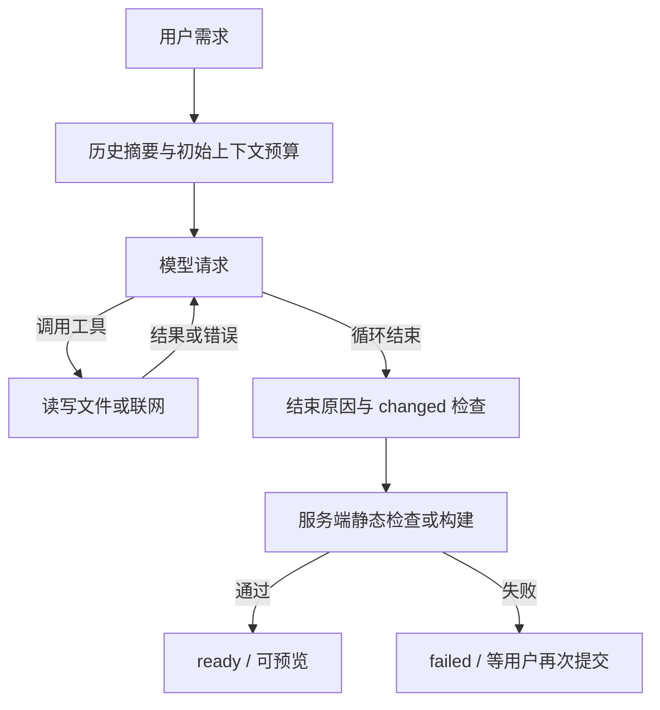
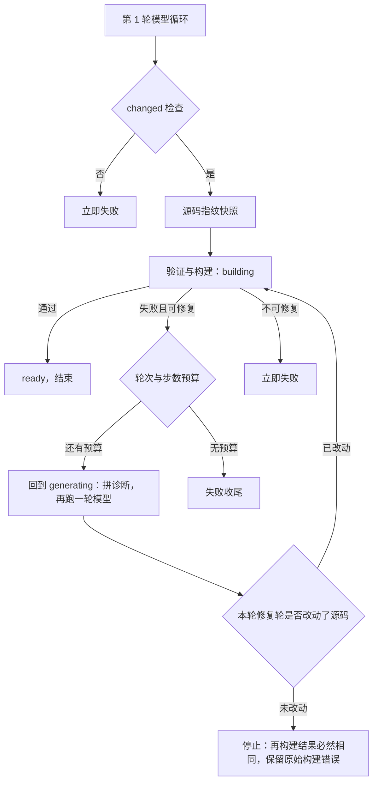

# Agent 设计评估与拓展建议

核对日期：2026-10-15。范围：当前 TypeScript 应用的生成 Agent、工具、历史上下文、任务生命周期及相关测试。

本文整合前两轮讨论，并按源码修正其中不准确的结论。它是候选迭代清单，当前只有 D4 已实现（见 §8 的实现状态），其余仍为候选，尚未确定实施范围。证据来自静态阅读，没有在本次整理中调用真实模型、复现故障或运行测试；下文的验收均指后续实施标准。

总体判断：当前已经有工具反馈、写权限控制、任务状态管理和构建验收。主要缺口集中在质量评估、执行中的上下文治理、构建失败修复，以及对完成状态的解释。继续沿用 AI SDK 即可推进这些工作。

## 1. 已有能力与讨论修正

| 方面 | 当前实际能力 | 证据与边界 |
| --- | --- | --- |
| 模型与工具循环 | `ToolLoopAgent`，最多 30 步；工具结果回到后续模型请求，工具参数错误可以被模型修正 | [agent.ts](../../src/server/agent.ts)、[SDK 工具循环测试](../../tests/agent-loop.test.ts)、[生成持久化集成测试](../../tests/integration/agent-persistence.test.ts) |
| 写权限与任务一致性 | 应用行锁、租约、心跳、请求去重、终态保护；取消后仍等旧任务退出再释放租约 | [generation-store.ts](../../src/server/generation-store.ts)、[并发与恢复测试](../../tests/integration/generation-store.test.ts) |
| 历史上下文 | 滚动摘要、近期完整回合、预算估算、摘要失败时的有界降级；原始消息保留 | [memory-context.ts](../../src/server/memory-context.ts)、[memory-window.ts](../../src/server/memory-window.ts) |
| 文件与构建约束 | 路径/符号链接检查、文件与工程配额、单文件原子替换、模板依赖保护、隔离构建 | [workspace.ts](../../src/server/workspace.ts)、[artifacts.ts](../../src/server/artifacts.ts) |
| 产物验收 | 静态应用检查入口/文件形态；框架工程执行真实构建，使用模板时执行类型检查；检查产物入口 | [artifacts.ts](../../src/server/artifacts.ts)、[Vue 真实构建集成测试](../../tests/integration/agent-vue-build.test.ts) |
| 集成与浏览器测试 | 已有请求到 `ready` 的集成测试、真实 Docker 构建、构建中断连测试、Vue 页面点击交互 E2E | [持久化测试](../../tests/integration/agent-persistence.test.ts)、[断连构建测试](../../tests/integration/generation-disconnect-build.test.ts)、[Vue E2E](../../tests/e2e/vue-generation.spec.ts) |

需要修正此前的说法：

- **不是没有端到端测试。** 缺少的是固定需求集上的真实模型质量评估。现有可控模型测试能验证平台行为，不能据此推出真实模型的需求完成率。
- **不是完全没有 usage。** 摘要调用会记录可靠的输入/输出 token，并保存在最新摘要行。缺少生成任务完整记账与历次调用累计；最新摘要行不能用于核算全部历史费用。见 [memory-model.ts](../../src/server/memory-model.ts)、[memory-store.ts](../../src/server/memory-store.ts)。
- **摘要不会删除原始历史。** 当前缺少会话树和摘要版本回溯能力，但保留了原始消息，不能称为不可恢复的历史丢失。上下文降级会让部分历史暂时不进入模型，这与删除原文不同。
- **逐步落库不等于断点续跑。** 同一 assistant 消息 ID 会被反复更新；进程失联后回收租约并标记失败，没有自动重启模型循环或安全重放工具的协议。
- **取消不总是需要等 5 秒。** 同进程可以直接 abort；跨进程的取消状态由心跳轮询发现。构建阶段继续完成是代码和测试明确保留的行为。
- **AI SDK 不只提供开始/结束回调。** 当前安装版本也支持 `prepareStep` 等扩展点；应用尚未接入这些能力。缺少中途预算检查不能归因于 SDK 无法支持。

使用 SDK、没有多 agent、没有强制 planning/reflection、没有独立 tracing 平台，都不能单独判定为设计缺陷。只读研究 Agent 也可以成立，不要求所有 Agent 都修改外部状态；本项目关注的是在有限预算内完成网站需求，并提供可核验的结果。

## 2. 当前执行链路



已有工具层反馈闭环。主要断点是：构建发生在模型循环结束后，构建错误直接进入失败收尾；运行中的新工具输入/结果也没有经过下一步上下文预算规划。

## 3. 核心缺口及对应改进

P1 表示建议近期优先，P2 表示在基础测量和可靠性完善后推进，不表示已发现生产事故。

| 编号 | 缺口 | 证据状态 | 对应改进 | 建议优先级 |
| --- | --- | --- | --- | --- |
| D1 | 缺少固定需求集与真实模型质量基线 | 已确认，未做本次真实模型评估 | Eval harness | P1 |
| D2 | 生成任务用量、步骤耗时、失败原因缺少统一记录 | 已确认；已有消息和摘要局部记录 | 任务/步骤记账与结构化诊断 | P1，与 D1 配套 |
| D3 | 初始预算不能约束单次生成内部持续增长的上下文 | 已确认缺少闸门；溢出概率未实测 | 分段读文件、工具内容限额、每步预算检查 | P1 |
| D4 | 构建失败没有返回模型形成修复闭环 | 已确认当前控制流 | 有预算的验证与修复，见 §8 | P1 |
| D5 | `ready` 无法证明用户需求与浏览器行为正确 | 已确认验收范围；实际误判率未测 | 浏览器冒烟与任务断言 | P2 |
| D6 | 完成判定与停止原因较粗，步数不能代表成本 | 已确认现有分支；边界需专项验证 | 细化结束原因、完成证据与预算口径 | P1，随 D2/D4 补齐 |

### D1：缺少质量评估基线

现状：测试覆盖了平台机制，但没有固定需求集，用来反复比较真实模型、提示词和工具策略。单次手动生成成功不能说明稳定成功率。

建议：先用少量分层需求跑通评估脚本，再扩展到 20–30 条。覆盖四种应用类型、首次生成、增量修改、长历史约束和失败修复。每个样例定义可检查的验收条件，并保存可审阅的产物与失败原因。

验收：相同任务集能对比两次运行；报告分别展示构建通过率、浏览器冒烟通过率、需求验收通过率、步数、耗时和 token。记录样例数、重复次数、模型实际标识、模板与代码版本；小样本结果不宣称为普遍成功率。

### D2：缺少完整记账与结构化诊断

现状：`ts_generation` 保存任务状态、错误和时间；UIMessage 保存工具过程；最新摘要行保存部分 usage。缺少按任务关联的生成模型用量、步骤/工具耗时、实际模型绑定、重试和明确停止原因。见 [schema.ts](../../src/server/schema.ts)、[agent.ts](../../src/server/agent.ts)。

实现状态与详细设计见 §9。

建议：先建立统一的任务/步骤记录，让 D1 可以消费。至少关联 `generationId`、实际模型标识、步骤序号、工具名、耗时、输入/输出 token、结束原因。摘要、生成与可观测的重试分开计量；无法获取的上游调用用量标记未知，不能记成零。费用使用可追溯的价格来源估算，不把聚合商官价当成实际账单。

验收：抽取一次成功、工具纠错、超时、取消和构建失败任务，可以回答它在哪里花时间、调用了什么、为何停止、哪些费用可确定。无需先部署独立观测服务，也不默认保存完整敏感提示词或工具正文。

### D3：运行中上下文缺少总预算

现状：`buildModelMessages` 在 `agent.stream` 前执行一次。随后本次生成内部累积的模型输出、工具输入和结果由 SDK 继续携带，没有应用层的每步预算检查。`readFile` 只接收路径，没有分页参数；文本可以整份返回到 256 KiB。`writeFiles` 的完整源码输入同样会占上下文，不能只限制工具结果。见 [agent.ts](../../src/server/agent.ts)、[workspace.ts](../../src/server/workspace.ts)。

建议分两层：先给文件读取增加分页/片段读取与明确的省略标记，再在步骤边界核算当前请求的总输入。限额同时考虑行数、字节和预估 token，避免超长单行绕过行数限制。预算应保留本轮目标、约束及 tool call/result 对应关系，并为输出预留空间。

验收：重复读取大文件、较大的 `writeFiles` 输入、超长单行和多步工具调用，都不会绕过应用预算持续膨胀；模型能按返回的续读位置取得后续内容。字符估算是启发式口径，仍需记录上游真实 usage 校准。本次没有复现模型窗口溢出。

### D4：构建验收与模型修复脱节

现状：文件工具自身的参数/依赖错误能回到模型纠正；模型结束后 `buildApp` 抛出的类型、打包或入口错误直接结束整次任务。两条路径需要区分。见 [agent.ts](../../src/server/agent.ts)、[artifacts.ts](../../src/server/artifacts.ts)。

建议：把必要的验证结果以有界诊断返回模型，允许少量修复尝试，采用服务端拥有的外层修复循环。完整设计见 [§8](#8-d4-详细设计构建失败后的模型修复闭环)。

验收：人为注入一个可修复的类型或导入错误，模型收到诊断后修复并通过构建；不可修复错误、取消、租约失效和预算耗尽都能明确停止。修复共享任务写权及累计预算。现有 `building` 是完成构建后收尾的阶段，接入修复需要显式设计状态转移，不能简单把失败任务重新改回生成中。

### D5：产物检查尚不能证明需求完成

现状：HTML/多文件应用检查静态文件形态与 HTML 入口；框架工程构建，模板工程还检查类型。生成后的生产链路没有对每个产物执行浏览器功能验收。已有 Vue 点击 E2E 验证的是固定可控样例。发布截图也不是需求验收。

建议：先加能通用自动判断的浏览器冒烟：页面可打开、关键资源可加载、未出现阻断运行的异常。业务要求通过固定评估样例里的明确断言检验；视觉质量保留人工审阅，确有稳定参考时再考虑截图对比或模型辅助评分。

验收：能区分“构建通过但页面白屏”“页面打开但关键交互失败”“满足指定需求”。报告保留异常和截图证据。冒烟通过不等于全部需求通过，视觉模型评分也不作为唯一成功判据。

### D6：完成、停止和预算的语义需要细化

现状：`changed` 在文件写/改/删成功返回后设为真，它不等于有效源码差异，也不证明需求完成。没有写文件会被统一判为失败。最终回复为 `length` 时允许继续构建，这是已有回归测试覆盖的行为。步数到限与其他结束原因缺少面向用户和评估的细分类。

预算方面已有 30 步、步骤计时、可配置阶段时限和构建超时。默认 `GENERATION_TIMEOUT_MS=0`，阶段时限开启时会在转入构建后重置；它不是覆盖整次任务的绝对截止时间。一步可能包含多个工具调用，步数也不代表总 token/费用。见 [config.ts](../../src/server/config.ts)、[预算测试](../../tests/generation-budget.test.ts)、[生成持久化测试](../../tests/integration/agent-persistence.test.ts)。

建议：分开记录模型停止原因、应用停止原因与验收结果，例如正常结束、输出截断、步数耗尽、超时、取消、失去写权和验证失败。保留“回复截断但产物完整仍可成功”的行为，用独立验收判定结果。是否支持“需求已经满足而无需修改”的成功回应，由产品语义决定；不应为了通过 `changed` 而制造无用写入。

验收：正常完成、最后说明截断、步骤耗尽、没有写入、没有有效差异、验证失败，都有可解释且可区分的结果。若接入修复，必须明确累计 token/步骤/时间的停止规则，不能每次修复重新获得无限预算。

## 4. 设计风险与当前取舍

这些是已确认的实现边界，其影响程度尚未通过本次故障复现或负载测试确定，不能直接列为必须立即修复的线上故障。

| 编号 | 边界或风险 | 当前事实 | 建议 |
| --- | --- | --- | --- |
| R1 | 失败任务可能保留部分源码修改 | 单文件采用临时文件加 rename；`writeFiles` 逐个写入。后续文件失败或任务取消，不会回滚已经完成的文件写入。数据库事务不能回滚文件系统。框架构建有暂存和 dist 替换保护；静态源码又直接参与预览 | 先明确“失败保留草稿”还是“失败恢复旧版本”。需要后者时再做任务级暂存/快照和提交，不把数据库行锁称为源码事务 |
| R2 | 步骤记录与文件副作用不构成原子 checkpoint | 工具可能已经写入文件，但进程在对应步骤消息落库前退出。租约回收会标记失败，没有安全重放协议 | 真正实施续跑前，定义意图、已完成效果、未知结果和工具幂等规则；避免盲目重放修改/删除/素材导入 |
| R3 | 构建期间持有较长数据库事务 | `buildApp` 运行在 `write()` → `withAppWriter()` 内，事务持有应用行锁并占用连接；租约行默认不加长锁以避免阻塞心跳 | 小规模个人项目先测量构建并发、连接占用和锁等待；出现实际瓶颈后，再设计事务外构建与提交时写权校验 |

证据：[workspace.ts](../../src/server/workspace.ts)、[agent.ts](../../src/server/agent.ts)、[generation-store.ts](../../src/server/generation-store.ts)、[artifacts.ts](../../src/server/artifacts.ts)。

## 5. 可选拓展与适用条件

| 拓展 | 能解决什么 | 最小可用范围 / 前置条件 | 相对投入 |
| --- | --- | --- | --- |
| 中途插话 steering | 用户发现方向偏了，可以追加约束 | 工具批次结束、下一次模型请求前注入；消息持久化并有接收反馈。已执行的工具不会自动撤销，新的约束从明确边界生效 | 中到高 |
| 后续任务排队 follow-up | 当前任务完成后继续下一项需求 | 与 steering 分开定义。只有用户确实需要排队操作时再加，避免引入多种难解释的发送模式 | 中 |
| 断线后继续查看执行流 | 刷新后接回仍在运行的任务 | 区分模型生成和构建阶段的断连策略；需要事件重连、游标及去重，不能只开前端 resume 开关 | 中到高 |
| 进程崩溃后续跑 | 重启后继续未完成任务 | 依赖 R2 的安全恢复协议；与恢复聊天显示、重新订阅流分别设计 | 高 |
| 项目需求记忆与历史检索 | 长对话中找回早期约束和决策 | 先用评估样例证明滚动摘要的具体遗漏；再考虑显式需求记录或按需检索，利用现有原文，不默认引入向量库 | 中 |
| 工程内搜索与渐进披露 | 多文件修改时减少整文件读取和无关上下文 | 复用 D3 的分页契约，可补有界的文件内容搜索；按真实调用/读取数据判断是否需要更多工具或技能机制 | 低到中 |
| 构建进度与工具增量反馈 | 长操作期间让用户看懂进展 | 先展示安装、类型检查、打包等明确阶段；输出有界日志，避免把所有日志塞回模型 | 低到中 |
| 多 agent / 子任务并行 | 可独立分工的复杂任务 | 先证明单 Agent 瓶颈，定义文件写入所有权与合并验收；初期可探索只读审查，避免共享目录并发写 | 高 |
| MCP / 通用插件工具 | 连接外部能力或复用第三方工具 | 有具体接入需求后实施；保留工具权限、输出预算和错误契约 | 中到高 |
| 全栈网站生成 | 将产物扩展为带数据与后端逻辑的完整网站 | 独立产品方向；运行时、数据层、部署目标尚待选择，沿用[已有调研](fullstack-generation-research.md)，不在本清单里自动定案 | 高 |

数据库迁移属于基础设施演进，不能单独证明 Agent 生成质量提升；是否先做应由迁移收益与当前阻塞决定。缓存优化也应先从 D2 测出成本构成，再决定是否值得投入，暂不照搬 pi 的 cache warmer。

## 6. 建议实施顺序与交付物

1. **建立测量基线：D1 + D2。** 交付可复跑的小型真实模型评估、任务/步骤记账、失败分类报告。评估脚本可以先搭，记账按其需要补齐，两者共同验收。
2. **约束执行中的上下文：D3，配套 D6 的预算耗尽语义。** 交付分页读取、有界工具内容、每步预算检查，以及修改前后的步数/token/完成率对比。即使评估样本尚少，也可先补明确的预算边界。
3. **让验证驱动修复：D4，配套 D6 的状态转移。** 交付类型/构建错误的有限修复闭环，记录修复成功率与新增成本，确认它是否减少用户再次提交。
4. **提升验收可信度：D5。** 交付浏览器冒烟和样例需求断言，将构建通过与真实可用分别报告；其样例断言也可以提前用于 D1。
5. **再选一项交互或产品拓展。** 根据前四步数据与用户体验，在 steering、需求记忆、续流或全栈方向中选；R1–R3 随对应功能或实际测量结果处理。

第一轮不需要重写通用 Agent 框架，也不要求把全部候选功能做齐。项目规模按个人开源求职作品评估；以上排序来自当前代码缺口、实现成本与可展示的工程证据，没有在本次整理中重新采样招聘岗位。

## 7. 评价口径

- **结果：** 构建、运行冒烟、需求断言分别计算通过率。模型说“完成”不作为唯一证据。
- **效率：** 每任务步骤、工具调用、输入/输出 token 与可确定费用，包含修复开销并标记未知用量。
- **体验：** 首次可见反馈耗时、总耗时、用户纠正/重新提交次数。当前系统尚未提供完整的人工干预次数统计。
- **可靠性：** 失败/取消后状态是否正确、租约能否释放、源码与预览保留什么、重试是否可能重复副作用。
- **可解释性：** 能定位哪一步失败、为何停止、哪些结论来自真实验收，哪些仍需人工审阅。

## 8. D4 详细设计：构建失败后的模型修复闭环

本节是针对 §3 中 D4 的设计建议。文中标 **（已验证）** 的结论来自已安装依赖的类型定义或现有代码与测试，其余为设计判断。

### 8.0 实现状态（2026-10-15 已落地）

落地后与原设计的差异：

- 阶段标记没有进 `BusinessError` 或 `http.ts`：放在新模块 `src/server/build-feedback.ts` 的 `WeakMap` 里（`markBuildFailure` / `sourceFailure` / `classifyBuildFailure`），错误类型、消息与对外序列化一行未改。
- `containerRun(directory, step, ...)`：第一个参数仍是 stage 目录路径，新增显式的 `step`（`install` / `typecheck` / `build`）透传给 `command()`。
- 源码指纹在首次构建前取一次、每个修复轮结束后再取一次；未变即以原始构建错误结束（附「本轮模型未修改任何文件」）。
- 状态回退用新增的 `restoreGeneration(id)`（`building → generating` 的 CAS），修复轮重新变为可取消。
- 前端用 transient `data-build` 事件显示「构建未通过，正在进行第 N/M 次修复…」。
- 新增 `BUILD_REPAIR_ROUNDS`（0–3，默认 2），已写进 `.env.example`。

对应测试：`tests/build-feedback.test.ts`（分类与诊断纯函数）、`tests/integration/build-repair-loop.test.ts`（真实 `buildApp` 的 html 校验闭环：修复成功回到 `ready`、同一条 assistant 消息；无进展时保留原始错误且只有一次构建）、`tests/integration/agent-persistence.test.ts` 新增 4 例（诊断回传、无进展、不可修复、轮次耗尽）。

本次跑过的验证：`tsc --noEmit`、`vitest` 全量 449 例、`check:ui`、`check:e2e`、`test:e2e:dev`、`test:e2e:isolated`。容器重复安装的墙钟开销与真实模型的修复行为已实测（见 §8.10、§8.11）；仍未验证的是修复**成功率**（需要语料，属于 D1）与更多轮次是否值得。

### 8.0.1 闸门能被绕过（2026-10-15 实测）

修复轮给模型创造了一个新动机：“让构建通过”不等于“修好源码”——而当前闸门是可以被绕过的。在 `node:24-alpine` 里复刻 `containerRun` 的参数、registry 用 `.env` 里的 npmmirror，对真实 `vue_project` 工程实测：

| 注入方式 | `vue-tsc --noEmit` | 说明 |
| --- | --- | --- |
| `src/main.ts` 里写 `const n: number = 'text'` | `error TS2322`，失败 | 基准：真实类型错误确实被拦住 |
| 同一错误 + 文件首行 `// @ts-nocheck` | **无输出，通过** | 每文件抑制注释可静默绕过类型检查 |
| 同一错误 + `tsconfig.json` 改 `strict: false` | 仍然 `TS2322`，失败 | 放宽 strict 拦住不了普通类型错误 |
| `tsconfig.json` 改 `include: []` | `error TS18003`，失败 | 清空 include 会被 TypeScript 自己拦住 |
| 仅 `vite build` | exit 0 | 打包不做类型检查，类型闸门只有 `vue-tsc` |

影响：模型只要给出错的文件加一行 `@ts-nocheck`，就会得到一次“构建通过”。因此 §8.9 的验收里增加一项：修复轮不得以削弱验证的方式通过——对比修复前后的 `tsconfig.json` / `vite.config.ts` 指纹，并统计 `@ts-nocheck` / `@ts-ignore` / `@ts-expect-error` 的新增数量；评估阶段先记录不拦截，看到真实比率后再决定是否直接判失败。

### 8.1 目标与边界

目标：把“模型循环结束后才发生的验证失败”变成模型可见、可修、可终止的一次交互，不引入新的运行时，不改变安全边界。

不做：

- 不重写循环，不引入第二套 Agent 框架，继续使用同一个 `ToolLoopAgent` 实例。
- 不把验证暴露成模型可调用的工具：调用时机与次数不可控，会绕开“服务端拥有验证权”的前提。
- 不做源码回滚（R1 未决）；修复失败仍按现状保留已写入的草稿。
- 不在本轮做 D2 记账与 D3 运行中预算，但 §8.7 的预算累加必须先落地，否则修复会变相放大步数与时间上限。

### 8.2 总体结构：外层修复循环

把现在一次性执行的验证与构建改成有上限的修复循环，验证权始终在服务端：



关键点：只有服务端能触发验证；每轮之间只追加一条结构化诊断，不重新构建历史上下文；修复轮与首轮共享同一个 Agent、同一套工具、同一份租约与取消语义。

“本轮是否改动了源码”的判定位于 **修复轮模型循环之后**，不是构建之后：`G → H → D` 才是回到构建的路径，`F3`（无预算）是独立终点。这样画是因为它要挡住一次注定结果相同的构建。

### 8.3 状态与信号的转移

| 时刻 | `generations.status` | 取消语义 | phase 信号 |
| --- | --- | --- | --- |
| 第 1 轮模型循环 | `generating`（现状） | 可取消 | `controller.signal` |
| 验证与构建中 | `building`（现状） | 不可取消（现状，前端禁用停止按钮） | `building.signal` |
| 进入修复轮之前 | 回到 `generating`（新增） | 恢复可取消 | `controller.signal` |
| 最后一次验证 | `building` | 不可取消 | `building.signal` |

`setGeneration(id,'building')` 已经是 CAS（`WHERE status IN ('generating','building')`），所以“回退到 generating”不能复用它，需要新增限定来源的转移：`generation-store.ts` 增加 `restoreGeneration(id)`（`WHERE status='building'`），保持单点状态变更。

UX 结果：构建期间仍是“代码已生成，正在完成构建，构建无法取消”；一旦进入修复轮，按钮回到“停止生成”。现在“构建失败后只能重发一轮”的场景，变成用户可以直接中断。

现有两条测试契约仍成立，因为它们的构建是成功的（`tests/integration/agent-persistence.test.ts` 的“构建阶段的取消请求不中止构建”“客户端在构建中断开”）：新增的“失败 → 修复轮 → 取消”场景另写用例。

### 8.4 失败分类：什么交给模型

在 `artifacts.ts` 里给失败带上阶段：`containerRun` 增加 `step: 'install' | 'typecheck' | 'build'` 参数并透传给 `command()`；`command()` 在超时或非零退出时把 `step` 挂到 `BusinessError` 上（`http.ts` 的 `BusinessError` 增加可选第 4 参）。`failure()` 只序列化 status/code/message，用户可见文案与现有断言（如 `toMatchObject({status:504,code:50400})`）不变。

| 失败 | 来源 | 分类 | 理由 |
| --- | --- | --- | --- |
| `install` 阶段非零退出 | 容器 npm | 不可修复 | 依赖与 registry 由平台控制，生成源码不参与安装 |
| 构建超时（504） | 容器超时 | 不可修复 | 与源码无关，重试只会再花一份预算 |
| 容器启动失败、`ENOSPC`、`EACCES`、`ensureSafeDirectory`、`copySafeTree` 配额 | 平台侧 | 不可修复 | 不是源码问题 |
| `模板依赖锁已改变` | 源码旁校验 | 不可修复 | `assertTemplateFileMutable` 明确禁止模型改锁文件 |
| `不允许的构建依赖`、manifest 校验 | 源码 | 可修复 | 依赖清单由模型编写，错误文案已带允许版本 |
| `缺少有效 HTML 页面`、`构建没有输出 index.html`、静态脚手架的禁止文件 | 源码形态 | 可修复 | 纯源码问题 |
| typecheck / vite build 非零退出 | 容器类型检查与打包 | 可修复 | 错误定位到源码文件与行号 |
| 其他未知错误 | — | 不可修复 | 保守：不把模型预算花在无法解释的失败上 |

规则可以概括为一句话：**只有能定位到生成源码的失败才交给模型。** 分类与格式化做成纯函数，放在新文件 `src/server/build-feedback.ts`（与 `build-contract.ts` 同级），可单测且不依赖 Docker。

一个必须防的误判：容器里的资源类失败（`vite build` 被 OOM kill、磁盘写满、registry 连接中断）同样以非零退出结束，按上表会落入“可修复”，模型拿到的却是一条它无法从源码修复的诊断。建议在 `classifyBuildFailure` 里对输出做一次低成本特征匹配（`Killed`、`ENOSPC`、`ECONNRESET`、`ENOTFOUND`、`out of memory`），命中则降级为不可修复。代价很小，收益是不把环境噪声当成源码问题喂给模型。

### 8.5 反馈内容契约

现状：`buildFailureDetail()` 把容器输出 `replace(/\s+/g,' ')` 压成一行并只保留最后 400 字符。对日志尾部够用，对模型不够：类型错误的文件名、行号、列号常常在更靠前的位置，压缩空白还会把多行诊断揉成一句。

建议 `formatBuildFeedback(error, attempt, maxAttempts)` 产出有界诊断，形态如下：

```
验证未通过（第 1 次修复，共 2 次）。阶段：typecheck。
错误摘要：src/App.vue(12,7): error TS2339: Property 'title' does not exist on type ...
最近构建输出（尾部，中间已省略）：
<最多 4000 字符，保留换行，首尾各取一半>
请只修改导致该错误的源码；不要重新生成整个工程，不要改 package.json 依赖、锁文件或模板文件。改完直接结束回复，平台会自动重新验证。
```

规则：保留换行与 `文件(行,列)` 形态；容器内 `/work/` 前缀归一化为工程相对路径，让模型能直接对应 `readFile` 的路径；上限约 4000 字符（约 1.5–2k token），超限时保留开头（错误列表通常在前）与结尾（最终失败原因），中间标注省略量；三者用途不同，现有 16000 字符的 stdout 累积与 400 字符的 UI 错误文案保持不变。

### 8.6 消息组装与持久化（已验证）

- 第 2 轮的模型输入：`[...第 1 轮 ModelMessage[], ...第 1 轮 result.responseMessages, { role: 'user', content: 诊断 }]`。`responseMessages` 的语义是“本次调用累积的所有 assistant/tool 消息”（`stream-text-result.ts:291`），而 `agent.stream` 本来就接受 `messages: ModelMessage[]`（现有代码已这么调）。因此不需要重跑 `buildModelMessages`，也就不会在任务中途再次提交历史摘要。
- 每轮步数预算：`stopWhen` 只存在于 `ToolLoopAgent` 的 settings，`AgentCallParameters` 没有它（已核对 `node_modules/ai/src/agent/agent.ts`）。所以用闭包变量控制每轮剩余步数：`let remainingSteps = 30; stopWhen: ({steps}) => steps.length >= remainingSteps`，每轮开始前重算。这与现有 `changed`、`phase` 闭包风格一致。
- UI 流：`handleUIMessageStreamFinish` 在 `originalMessages` 末尾是 assistant 消息时沿用同一个 message id 追加（`isContinuation = state.message.id === lastMessage?.id`）。所以第 2 轮传 `[...第 1 轮 validated, 第 1 轮 responseMessage]`、`generateId` 仍返回 `${requestId}-assistant`，界面上是同一条连续回复，不会出现两条 assistant 气泡。
- 诊断消息不写入消息表：它是一次性平台反馈，重放会误导后续回合。展示用 transient data part（`{ type: 'data-build', data: { status: 'verifying' | 'repairing' | 'failed', attempt, maxAttempts } }`），前端在 `onData` 里显示“第 N 次修复中”。需要审计时再按保留前缀单独存表，不在本次范围。

### 8.7 预算与终止

| 预算 | 现状 | 修复循环下 |
| --- | --- | --- |
| 模型步数 | `isStepCount(30)`，单轮 | 首轮与修复轮共享 30 步，每轮取剩余值；剩余为 0 时不进入修复 |
| 每步回复超时 | `armReplyTimer` 每步重置 | 不变，每轮每步仍然生效 |
| 阶段超时 | 默认关闭（0），`generating → building` 时重置一次 | 每轮重置。总时长上界因此是轮次×时限，若需要绝对截止，须另加任务级计时器（见 §8.10） |
| 构建超时 | `BUILD_TIMEOUT_MS` 作用于每次容器命令 | 每次验证照旧，最坏等于轮次×构建预算 |
| 修复轮次 | 无 | 新增 `BUILD_REPAIR_ROUNDS`，取值 0–3，默认 2（0 表示关闭）。两次基本覆盖类型错误与导入路径这两类常见失败，再多会显著拉长用户可感知的墙钟时间 |
| 无进展终止 | 无 | 每次失败后记录源码指纹（`sourceDigest`），修复轮结束后指纹未变则立即停止 |

“无进展终止”的判定依据是构建的输入同一性：源码与锁文件构成容器构建的全部输入，输入逐字节相同、镜像不变，输出必然相同。指纹未变时再构建一次只是把同一个错误重打一遍，代价却是一次真实容器执行（本机实测约 15 秒，见 §8.10；`BUILD_TIMEOUT_MS` 是上限而不是预计值），所以直接停在判定点上。

它同时挡住“模型声称已修复但没有写文件”的空转与重复同一错误的循环。这类无进展不应该“再多给一轮”：同样的输入不会产生新信息，预算应该花在有信息量的循环上；用户重发一次更便宜，因为他可以补充新信息。

这条路径的失败归因必须写对：模型没有修改文件有三种可能——对着诊断无从下手、判断问题不在源码、或者失败本来就是环境噪声。因此错误消息以**原始构建错误**为主，附一句“本轮模型未修改任何文件”；不要把“未产生新改动”本身当成失败原因，否则用户看到的是一个与实际病因无关的结论。

### 8.8 代码落点

| 文件 | 改动 |
| --- | --- |
| `src/server/build-feedback.ts`（新） | `classifyBuildFailure` 与 `formatBuildFeedback` 纯函数 |
| `src/server/artifacts.ts` | `containerRun` 增加 `step` 参数并透传；`command` 把 step 挂到 `BusinessError` |
| `src/server/http.ts` | 设计里曾计划加可选阶段字段，实现时改为在 `build-feedback.ts` 里用 `WeakMap` 打标，该文件未改 |
| `src/server/generation-store.ts` | 新增 `restoreGeneration(id)`（`building → generating` 的 CAS） |
| `src/server/agent.ts` | 抽出 `runRound()`，改成有上限的修复循环；闭包 `remainingSteps`；`data-build` 事件 |
| `src/server/config.ts` | `BUILD_REPAIR_ROUNDS`（与 `BUILD_TIMEOUT_MS` 并列） |
| `src/app/app/chat/[id]/page.tsx` | `onData` 处理 `data-build`；tsx 改动会触发 `check:ui` 与 `test:e2e:dev` 门禁 |

明确不做：把验证做成工具；修改 `buildApp` 的返回类型（`tests/artifacts.test.ts` 断言 `resolves.toBeUndefined()`，改动会牵动无关测试，需要源码指纹时在循环里单独调用 `sourceDigest`）。

### 8.9 测试与验收

可控模型即可覆盖（不需要真模型）：

1. **可修复路径**：第 1 轮写入缺类型标注的 TS/Vue 源码，断言第 2 轮模型收到的诊断包含 `error TS` 与文件名，修复后 `ready`。
2. **不可修复路径**：用既有手法（黑洞 registry）制造 install 或超时失败，断言没有发生第二轮模型调用。
3. **无进展终止**：第二轮不改任何文件，断言只验证了两次、任务 `failed`、错误说明未产生新改动。
4. **取消语义**：修复轮期间取消 → `cancelled` 且租约释放；修复失败后的最后一次构建期间取消 → 仍按现状完成。
5. **预算不放大**：把小步数上限跑满，断言两轮总步数不超上限。
6. **纯函数单测**：`classifyBuildFailure` 的每一类；`formatBuildFeedback` 的长度上限、换行保留、`/work/` 归一化。
7. **真实容器**：在 `tests/integration/agent-vue-build.test.ts` 附近注入真实编译错误，验证真实构建失败后能被修复到 `ready`，并记录第一次失败的 stage（受 `BUILD_TIMEOUT_MS` 与 vitest 300s 约束，属较慢用例）。
8. **验证完整性（见 §8.0.1）**：修复轮不得以 `@ts-nocheck`、放宽 `tsconfig.json` 或重写 `vite.config.ts` 的方式通过。最小形式是先记录、后拦截：快照 `tsconfig.json` / `vite.config.ts` 指纹与抑制注释数量，在报告里单列一栏。

验收口径：能回答“这次失败是否可修复、模型修了几次、最终是否真的构建通过、修复额外花掉了多少步与时间”。“构建通过”与“需求满足”仍然分开看，后者是 D5；修复是否以削弱验证为代价单独看，不算作修复成功。

### 8.10 未决与暂缓

1. **容器依赖安装会重复：已实测，结论是现在不值得优化。** 每次 `buildApp` 都新建 stage 目录并执行 `npm ci`，修复轮会再跑一遍。2026-10-15 在本机用 `.env` 的 registry（npmmirror）对真实 `vue_project` 工程实测：`npm ci` 8.6–11.0 秒（冷缓存，同一 stage 第二次仍然 11.0 秒，因为 npm 缓存落在容器的 tmpfs 里）、`vue-tsc --noEmit` 3.1 秒、`vite build` 1.5 秒，三段合计约 15 秒；`docker run` 启动开销约 0.2 秒/次，三次容器约 1 秒。即一轮修复的容器开销约 16 秒，真正的成本是模型的额外一轮而不是构建。`170 秒` 是官方源 + 机器负载下的旧数字，不是当前配置的常态；换 registry 或机器后该结论要重测。
2. **全局截止时间**：当前时限是“每阶段重置”，加入修复轮后单任务的绝对上界更难一眼看出。是否引入任务级总预算（步数＋时间＋token）属于 D6，建议在 D2 记账落地后用真实数据设定，而不是先拍一个数字。
3. **把验证做成模型可调用的工具**（如 `verify`）：能让模型在建中自查，但调用时机与次数不可控，且与“服务端拥有验证权”冲突。若采纳，应作为额外一次机会，而不是替代修复循环。
4. **诊断落库**：先不落库；需要审计时用保留前缀方案，不进 UIMessage 序列，避免污染后续回合与摘要。

### 8.11 真实模型实测（2026-10-15～16）

工具：`tests/manual/build-repair.eval.ts` + `vitest.eval.config.ts`，跑法 `npm run eval:repair`（不进 `npm run test`，因为它会调用真实模型并跑真实容器构建）。它不复制 agent 逻辑，只在边界上包一层：包 `buildApp` 记录每次构建的阶段/耗时/失败诊断与构建前后的源码快照，包 `taskModelsFor` 返回的模型记录每一步真正发给模型的输入，包 `generation-store` 记录状态转移与逐步落库。产物写到 `runtime/eval-repair/<时间戳>/`（报告、模型输入、SSE）。断言只保证“实验有效”与机制不变式；修复是否成功写在报告里。

场景：拿一份真实生成出来的 `vue_project` 工程，注入一个「可空值在模板里直接解引用」的类型错误（与历史真实失败同类的 `error TS18047`），然后让真实模型改首页标题。模型与容器都是真的：`codegen.default` 解析到本机 `.env` 配置的 provider。

| 时间 | 种子模式 | 基线 | 第 1 轮构建 | 修复轮 | 结果 | 步数 | 单步上下文峰值 |
| --- | --- | --- | --- | --- | --- | --- | --- |
| 16:28 | 注入晚于模型读取 | 通过 | typecheck 失败（真实诊断） | 发生，但两次 modifyFile 都没匹配上文本 | `failed`，错误以原始构建错误为主 + 「本轮模型未修改任何文件」 | 23 | 270KB |
| 16:34 | spare | 通过 20.2s | typecheck 失败 15.0s | 发生，模型删掉了出错表达式 | `ready`（第二次构建 20.2s 通过） | 14 | 130KB |
| 16:39 | required | 通过 21.2s | 模型在第 1 轮就自己修好了 | 未发生 | `ready`（无修复轮） | 19 | 264KB |
| 16:43 | spare | 通过 20.4s | typecheck 失败 15.8s | 发生，同样是删掉表达式 | `ready`（第二次构建 20.7s 通过） | 12 | 81KB |
| 01:39 | guard | 通过 14.8s | typecheck 失败 13.0s | 发生，**恢复了守卫** | `ready`（第二次构建 14.8s 通过） | 13 | 135KB |
| 01:47 | natural | 通过 11.0s | 通过 12.3s（一次成功） | 未发生 | `ready` | 16 | 121KB |

结论：

1. **机制端到端成立。** 真实 `vue-tsc` 失败被判定为可修复，诊断以 §8.5 的格式进入了 5–8 次模型输入，修复轮真的跑过（捕获到 `status=building → restore→generating → status=building → finish=ready`），平台的第二次完整容器构建通过，任务 `ready`，且前端只看到一条 assistant 消息（`落库消息=2`）、一个 `data-build` 事件。两种真实诊断各跑过一次：单行的 `src/views/CheckoutView.vue(176,38): error TS18047: '__VLS_ctx.pendingCouponTotal' is possibly 'null'.`（spare），以及多行的 `error TS18047: '__VLS_ctx.user' is possibly 'null'.`（guard，就是历史真正发生过的那一类）。
2. **修复动作取决于出错代码的归属。** 两次 spare 运行的修复都是 `modifyFile` 删掉出错表达式——在那里这是合理修法（那一行是评估注入的，不是用户需求）；而 `guard` 模式把出错点放在**必需的会员信息块**上（撤掉 `v-if="user"` 守卫），模型的动作是 `modifyFile(oldText='    <template v-if="true">', newText='    <template v-if="user">')`，即**补回守卫、保留全部必需信息**（报告里的 `guardRestored=true`、`requiredInfoKept=true`）。修复动作跟着“这行代码是否承载需求”走，而不是一律删。但平台自己看不出来这个区别：它只能证明 typecheck 通过。这正是 §8.0.1 与 D5 存在的理由——要判断“删掉算不算修好”，必须由需求级验收回答。
3. **无进展终止在真实运行里生效过（16:28）。** 模型的推理自述发现“我读到的文件里没有这个符号，可能平台改过文件”，于是它两次 `modifyFile` 都用了猜测的 `oldText`，工具以“旧内容必须唯一匹配”拒绝，源码没变，循环立即停止，最终错误保留了原始构建错误。附带说明：那次是注入时机造成的实验伪影（注入发生在模型读过文件之后），不是产品故障；但“模型拒改文件 → 立即停”的路径是被真实执行过的。
4. **种子不总能活过第 1 轮（好几次实例）。** 16:39 那次模型顺手把注入的错误表达式还原成了 `formatPrice(summary.total)`；01:35 那次（guard 的前一次尝试）模型在第 1 轮重写了 `AccountView.vue`，同样把撤掉的守卫恢复了。两者都是好行为，但也说明单种子只能做**案例**：要得到成功率必须靠固定语料（D1），并与 §8.9 第 8 条的“是否削弱验证”计数一起统计。
5. **顺带量到的成本结构。** 每轮容器校验 15–21 秒；真正贵的是模型：它会把整个工程读一遍，单个生成的上下文从 1KB 涨到 81–270KB，12–19 步、约 4 分钟墙钟。这是 D3（单次生成内部的上下文预算）的直接动机：本轮次里没有任何东西在约束它。
6. **自然生成：两次运行都没有触发修复轮。** 用空 `vue-ts` 模板 + 一个真实需求（记账小应用）跑 `natural` 场景，两次都是第 1 轮构建直接通过（01:47 那次 12.3s），模型写了 17 个文件、还删掉了模板自带的演示文件（`TaskItem.vue`、`useTasks.ts`、`types/task.ts`）。结合下面的历史数据，真实触发率确实很低。
7. **历史触发率（免费证据）。** 本机 dev 库 97 次非取消生成里只有 2 次可修复构建失败，其中一次就是真实发生过的 `src/views/AccountView.vue(194,53): error TS18047: '__VLS_ctx.user' is possibly 'null'`；另有一次安装阶段失败（`npm error code ETIMEDOUT`，分类正确为不可修复）。即真实触发率很低，这个功能的价值主要在“失败时不用用户再发一句重试”，不在提升成功率基线。

局限：种子是注入出来的（`EVAL_SEED_MODE=spare|required|guard`），没有 `BUILD_REPAIR_ROUNDS=0` 的对照（不必：注入之后直接构建已证明种子会让构建失败）；单模型、单提示、n 很小，不能当成功率；`required` 模式（把已有渲染接到可空变量上，删掉会丢用户可见信息）两次都没能进入修复轮——模型要么在第 1 轮就顺手修好，要么它自己没触发修复。

工具自身的已知问题：`natural` 模式报告里的 `changed` 字段不可信任（它按“基线快照 vs 第 1 轮快照”的哈希差异算，实测把一批模型根本没碰过的模板文件也列了进去，原因未查清）；判断模型到底写了什么、删了什么，以**工具调用记录**为准（本文的数据就是这么得到的，写工具是 `writeFiles`/`modifyFile`/`deleteFile`）。

本次交付为评估、设计记录与评估工具。除 §8.0、§8.10、§8.11 标为“实测”的数据外，没有运行压测或故障注入。

## 9. D2 详细设计：生成任务统一记账

实现状态：2026-10-16 已落地（`migrations/010_generation_accounting.sql` + `011_generation_message.sql`、`src/server/generation-accounting.ts`、前端 `src/components/chat/generation-usage.tsx`），评估工具的执行记录仍保留在 §8.11。

补充（同日）：最初只把读接口留在服务端，用户反馈「前端看不到用量」——一次生成对应一条助手回复，所以用量改成挂在回复气泡上（`ts_generation.messageId` 记录这次生成写出的助手消息 id，`GET app/generation/accounts?appId=&limit=` 返回最近几次生成的记账，前端按消息 id 匹配）。看板、跨应用聚合、费用估算仍然不做。

### 9.1 目标与边界

要回答的问题：一次生成在哪里花时间、调用了什么、用了多少 token、为什么停下。不做的事：不新增后台/看板/跨应用聚合（只读「这个应用最近几次生成」，不做趋势图与费用汇总）；不做费用估算（按 D2 原文，价格来源可追溯之前不把聚合商官价当账单）；不保存提示词、工具正文、模型输出或构建日志正文（§8.10 第 4 条：诊断不落库）；生成中不轮询明细（回复结束后取一次，避免把气泡里的用量做成实时看板）。

### 9.2 数据模型

`ts_generation_step`：每个模型步骤、每次摘要调用、每次构建尝试各一行（`kind` = `model` / `summary` / `build`）。

- `round` 是这个步骤所属的模型轮次，首轮为 1，每次构建失败后的修复轮 +1；构建尝试行记触发它的轮次。
- 用量的 NULL/0 区分：`inputTokens` 等为 NULL 表示上游没有返回用量，0 表示已知的零。汇总时跳过 NULL，只要有一步未知就把合计标记为未知（`usageUnknown`），避免把未知记成免费。
- 实际绑定与实际路由分开记：`modelAlias`/`providerId`/`modelName` 是注册表里的绑定（§8.11 的教训：报告必须记模型实际标识）；`upstreamProvider`/`upstreamModelId` 是 SDK 归一化后真正响应的模型，两者不一致正是路由/降级要查的线索。
- 耗时三段分开：`modelMs` 等模型响应，`toolMs` 执行工具，`durationMs` 整个步骤（含排队与流式输出）；构建与摘要的 `durationMs` 是墙钟。
- `toolCalls` 只存 `{name, ok, ms}`；参数错误的 `tool-input-error` 与执行失败都记 `ok=false`，正文不落库。
- `finishReason` 记模型自己的停止原因（`stop`/`length`/`tool-calls`…），与任务级 `stopReason` 分开。
- 外键 `generationId → ts_generation(id) ON DELETE CASCADE`：测试或未来的数据保留策略硬删任务时步骤随之回收；表不设 `createTime` 之外的区间索引，读法是按任务整段取。

`ts_generation.messageId`：这次生成写出的助手消息 id（`agent.ts` 的 `generateId` 生成，形如 `<generationId>-assistant`），前端据此把用量挂到对应的回复气泡上；没有落库回复（初始化失败等）时为 NULL。存 id 而不是让前端解析字符串，也不给 `ts_message` 加列（消息体本身是 JSON）。

`ts_generation.stopReason`：任务级停止原因，取值 `completed` / `no-changes` / `step-limit` / `verification-failed` / `timeout` / `cancelled` / `lease-lost` / `model-error` / `initialization-failed` / `interrupted`。取消与超时从 abort 信号区分（带原因的 abort 不是用户取消）；`interrupted` 由租约回收写；`beginGeneration` 的启动恢复写 `initialization-failed`。停止原因只在终态写一次，`finishGeneration` 遇到并发取消/回收时保留已有值。

### 9.3 写入与读取

写入全是尽力而为：记账失败只告警，不影响生成与状态转移。写入点在 `agent.ts` 的四个位置——`onStepEnd`（模型步骤，复用给刷新回复计时器的钩子，不额外注册），`verify()`（每次构建，成功/失败/取消都记，失败带 `build-feedback` 的分类与阶段），`consolidateHistory`（每次摘要调用，含失败），以及 `finishGeneration`（任务级）。

读取有两个入口：`generationAccount(generationId)`（单次任务，服务端评估/脚本用）与 `generationAccounts(appId, limit)`（一个应用最近几次生成，新→旧，一次 `IN` 查询取回所有步骤）。HTTP 上只暴露后者：`GET app/generation/accounts?appId=&limit=`（默认 10、上限 20，权限与 `app/generation` 一致：创建者或管理员）。返回形状是 `GenerationAccount`（`@/shared/contracts`）：状态、停止原因、模型标识、按 `kind` 的合计（模型/摘要/构建、墙钟总时长）与逐步明细。

前端：`src/components/chat/generation-usage.tsx` 渲染一条回复的用量（`<details>` 摘要行 + 逐步表格），挂在对应的助手气泡里；生成结束后取一次，失败静默（读不到记账不影响对话）。

### 9.4 与 D1 / D6 的衔接

D1 的评估报告可以直接用 `totals`（构建通过率、步数、耗时、token 与未知用量标记），不必再自己包一层计时；D6 的预算（步数、绝对时长、token）应当用这里的真实分布来定——比如“一轮修复平均多花多少 token/秒”现在是可观测量，而不是估计值。

### 9.5 测试

- `tests/generation-accounting.test.ts`：停止原因分类的纯函数用例。
- `tests/integration/generation-accounting.test.ts`：真实 `buildApp`（html 校验，不需要 Docker）跑五种任务——成功、工具参数错误后重试、上游不返回用量、模型不写文件、客户端取消——从 `ts_generation_step` 读回断言步骤、工具成败、token 与停止原因。
- 既有用例补了 `stopReason` 断言（超时/取消/不可修复/无进展/修复耗尽/模型流失败/长度截断）。
- `tests/integration/http.test.ts`：`app/generation/accounts` 返回的 `messageId` 与持久化的助手消息 id 一致，合计里有模型步骤与一次通过的构建；`tests/e2e/platform.spec.ts` 断言用量块出现在助手气泡里、展开后能看到逐步行。
