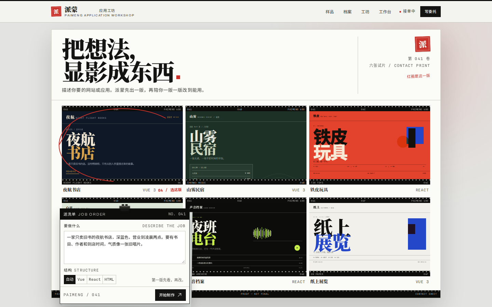
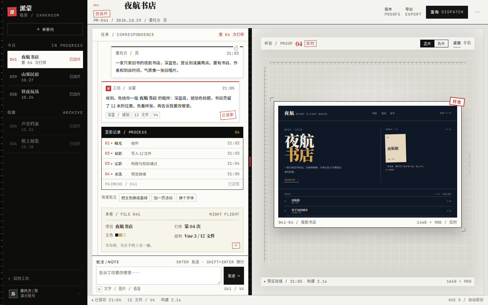
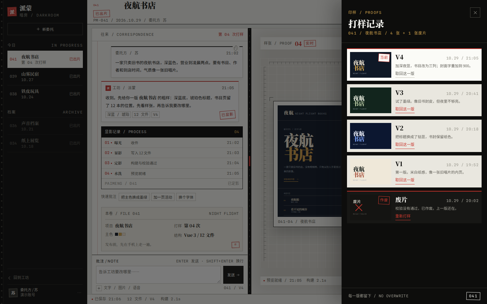
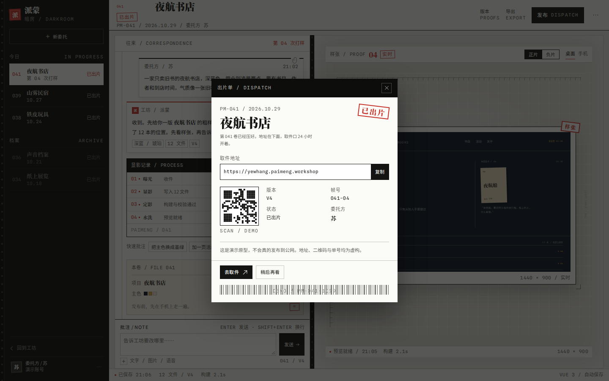
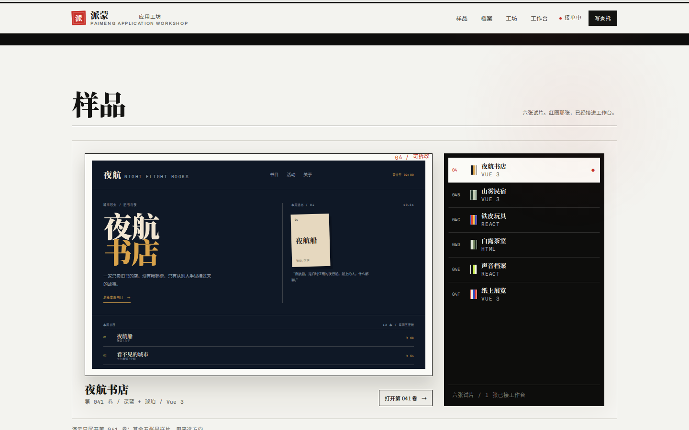
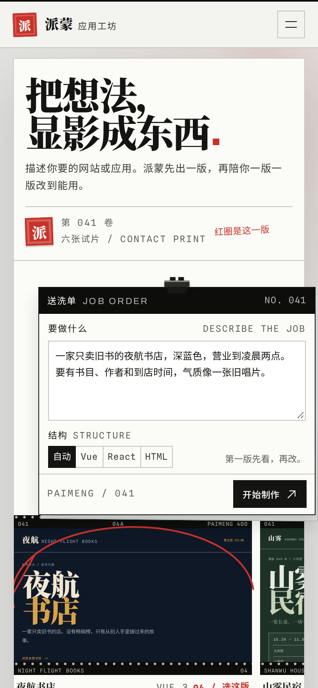
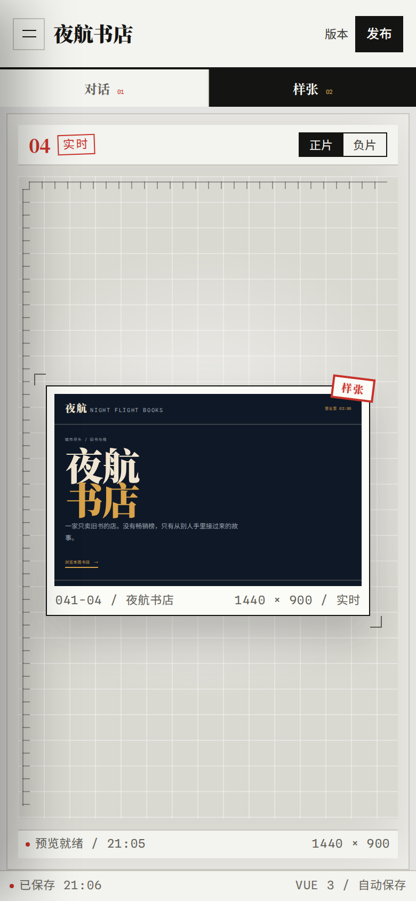

# 派蒙应用工坊 · 暗房

**把想法，显影成东西。** 这是第二份界面原型，完全另起一套世界，不是 [`v0-pi`](../v0-pi/) 的改版；旧原型没有改动。

它把 AI 生成放进一间暗房：首页是一张**接触印相（contact sheet）**，上面压着一张**送洗单**；工作台是一张**灯桌**、一叠**样张**、一卷**胶片**。生成不是“点一下出结果”，而是曝光、显影、定影、水洗；版本是印样；发布是出片。

## 打开

直接双击 `index.html`。字体、图标、样张全部本地，没有外链。

也可以起静态服务器：

```bash
cd docs/prototypes/deprecated/darkroom
python3 -m http.server 8000
# http://127.0.0.1:8000
```

## 设计方向

> 完整的颜色、字号、组件和规则见 [DESIGN.md](DESIGN.md)。

**不是 v0 的骨架刷 pi 的皮。** 上一版借用了 v0 的中心输入 + 模板广场，和 pi.dev 的羊皮纸、细网格、衬线；这一版把整个产品搬进摄影暗房，用暗房自己的物件组织页面。

- **首屏不是 hero + 卡片。** 它是一整张接触印相：六张试片、胶片齿孔、帧号、红铅笔圈出的第 04 张，以及一张用夹子夹在左下角的送洗单。写委托就是写工单；第一版就是第一张印样。
- **颜色是暗房的，不是 AI SaaS 的。** 相纸白 `#f3f3ef`、胶片黑 `#0d0d0c`、安全灯红 `#c8322a`、银 `#b7b5ad`。彩色的只有“作品”：六张试片和灯桌上的样张；界面本身保持单色 + 一点红。
- **字体分工。** Noto Serif SC 900 承担大标题和样张书名；Noto Sans SC 承担正文；Archivo 做拉丁标签和卷号；Spline Sans Mono 只做帧号、时间、代码。全部自托管。
- **材料即组件。** 胶片齿孔边、接触印相、打样记录、灯桌、负片代码视图、出片单。没有圆角卡片堆，没有发光渐变按钮，也没有玻璃拟态。
- **保留的挑战者纪律。** 网格对齐来自 teletext；逐行可追溯来自提花织机；一次显影/一次抬出的机械感来自纸偶；建筑尺度的字来自街头海报。只取纪律，不取它们的衣服。



## 工作台



- 左边是黑房工单栏：第 041 卷、山雾民宿、铁皮玩具、档案。
- 中间是**往来**：委托方和工坊的纸条、显影记录、可点击的快速批注，以及底部的本卷资料卡。
- 右边是**灯桌**：一张白边样张，带裁切角标、红“样张”章、帧号、实时状态；上面可以切“正片 / 负片”、桌面 / 手机。
- 顶部“版本”打开打样记录；“发布”打开出片单。版本、发布、导出都对应真实产品里的入口。

### 打样记录



四张有效印样按时间倒序排；当前版有红章，旧版可以取回。取回会同步切换样张主题、字体、活动页、帧号和发布版本。末尾还有一张作废的废片，带“重新打样”的恢复入口。

### 出片单



发布确认是一张带复写层、二维码、条码和“已出片”章的出片单。地址、二维码、单号都是演示数据。

## 样品



六张试片：夜航书店、山雾民宿、铁皮玩具、白露茶室、声音档案、纸上展览。右侧是胶片索引，点击切换灯桌上的大幅样张。

只有**夜航书店（第 041 卷）**接进了工作台；其余五张是视觉样片。这是刻意的：原型只展开一条完整流程，不假装六个项目都能操作。

## 移动端

 

- 首页：标题、送洗单、横向接触印相；菜单展开为整页白色单子。
- 工作台：工单栏变抽屉；“对话 / 样张”两个页签切换；版本、发布仍在顶部。
- 所有关键操作都能在 390px 宽下完成；没有横向溢出。

## 交互

| 位置 | 操作 | 结果 |
| --- | --- | --- |
| 首页 | 在送洗单写需求 → 开始制作 | 盖上“已收件”，进入工作台，开始第 05 次打样 |
| 首页 | 样品索引 | 切换大幅样张；只有第 041 卷可打开 |
| 首页 | 档案第 041 行 | 打开工作台；其他行只提示演示 |
| 首页 | 写委托 / Cmd·Ctrl+Enter | 滚回送洗单并聚焦输入框 |
| 工作台 | 快速批注 / 输入框 | 第 05、06…次打样；主色、活动页、字体是真实变化 |
| 工作台 | 正片 / 负片 | 样张 ↔ Vue SFC 负片代码 |
| 工作台 | 桌面 / 手机 | 16:10 桌面样张 ↔ 390×760 手机样张 |
| 工作台 | 拖动中间胶片条 | 调整对话 / 灯桌宽度；方向键也能调 |
| 工作台 | 版本 → 取回这一版 | 样张主题、字体、活动页、帧号、发布版本一起切换 |
| 工作台 | 版本 → 废片 → 重新打样 | 关抽屉，把上一版批注放回输入框；发送即重开一版 |
| 工作台 | 发布 → 复制 | 复制演示地址；二维码与条码均为演示 |
| 工作台 | Esc | 关抽屉 / 弹窗 / 移动工单栏；生成中则暂停本版 |
| 工作台 | 移动端菜单 / 对话·样张 | 工单抽屉、面板切换 |

生成中的暂停会回到上一版，不会留下半成品。每一版留下一张新印样；版本列表只增不覆盖。

## 真实与演示

- **真实可操作**：写委托、生成时间线、暂停、对话修改、三种快速批注（主色 / 活动页 / 字体）、正片负片、桌面手机、版本取回、废片重开、发布确认、复制、移动端抽屉。
- **固定演示**：夜航书店是唯一接入工作台的样片；生成是 3.8 秒前端模拟；代码视图是手里的 Vue 样张；版本是主题 / 字体 / 活动页的视觉变体，不是真实源码 diff；废片是固定在抽屉里的失败记录；发布地址是虚构的。
- **没有接入**：登录、后端数据库、真实模型、真实部署、管理端、模型配置、图片/语音上传。
- 所有项目名、委托方、日期、版本号、二维码和网址均为演示数据。

## 验证

- Playwright 在 `1440×900`、`1280×800`、`1024×768`、`390×844` 下走通：首页 → 送洗 → 生成 → 暂停/完成 → 色/活动页/字体修改 → 负片 → 手机 → 版本取回 → 发布复制 → 移动端抽屉。
- `file://` 直接打开正常：字体 `Noto Serif SC` / `Noto Sans SC` / `Archivo` / `Spline Sans Mono` 加载成功，无外部请求，无 console error。
- 接触印相、灯桌样张、出片单和移动端截图都来自真实渲染，不是拼图。

自动化设计检查（`impeccable detect`）里，**对比度问题为 0**。剩下的“小于 11px”主要是三类：胶片边码/帧号（6.5–9px）、样片内部的微缩文字（它们是作品，不是界面），以及品牌拉丁小字/工单存根这类印刷标记。界面上的操作、状态、字段、说明和演示披露都在 11px 以上，正文 12–16px。如果这版要进生产，建议把样片里的微缩文字单独做成可缩放的预览，而不是继续压小。

## 文件

```
darkroom/
  index.html          两个屏幕、抽屉、出片单
  style.css           完整世界：相纸/胶片、接触印相、灯桌、负片
  app.js              界面切换、生成、版本、发布、移动端
  DESIGN.md           颜色、字号、组件、响应式与规则
  fonts/              四个自托管 woff2 子集 + OFL 文本
  preview-*.png       渲染截图
  README.md
```

## 字体

| 字体 | 用途 | 许可 |
| --- | --- | --- |
| Noto Serif SC | 大标题、样张书名、信件 | SIL OFL 1.1 |
| Noto Sans SC | 正文、界面标签 | SIL OFL 1.1 |
| Archivo | 拉丁标签、卷号、英文小字 | SIL OFL 1.1 |
| Spline Sans Mono | 帧号、时间、代码 | SIL OFL 1.1 |

子集由 `pyftsubset` 从官方可变字体切出，只含当前页面用到的字符；完整授权见 `fonts/*-OFL.txt`，加工说明见 [`fonts/README.md`](fonts/README.md)。

## 已知取舍

- 六个样品只有第 041 卷可交互；其余是视觉样片。这是为了让一条完整流程做得更深，而不是做六条半成品。
- 生成暂停/取消会回到上一版；版本只记录主题、字体和活动页，并不记录真实源码差异。
- 废片是版本抽屉里的静态失败记录；真实的失败由后端状态驱动，这里只演示“作废 + 重新打样”的路径。
- 代码视图里没有“活动页”的代码；它是手工写的 Vue 样张，只用来表达负片这一层。
- “出片”是演示确认，不会真的发布。

如果要继续落地：把送洗单接到真实的 `app/add` + SSE；把灯桌换成真实 iframe；把版本抽屉接到现有版本接口；把出片单接到部署接口。视觉系统、字体和交互骨架都可以直接沿用。
