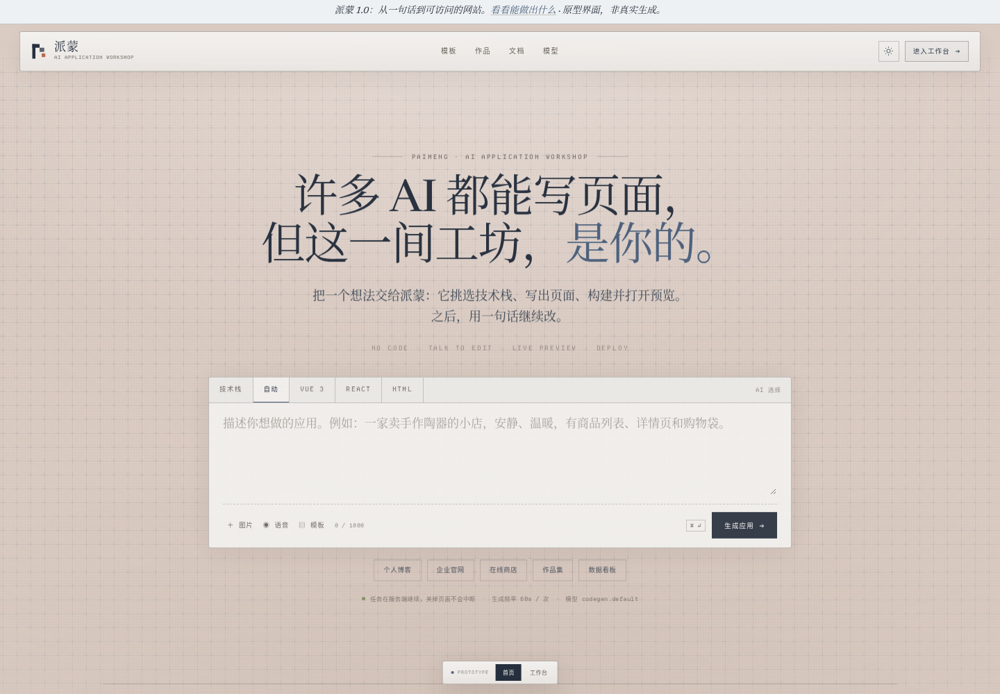
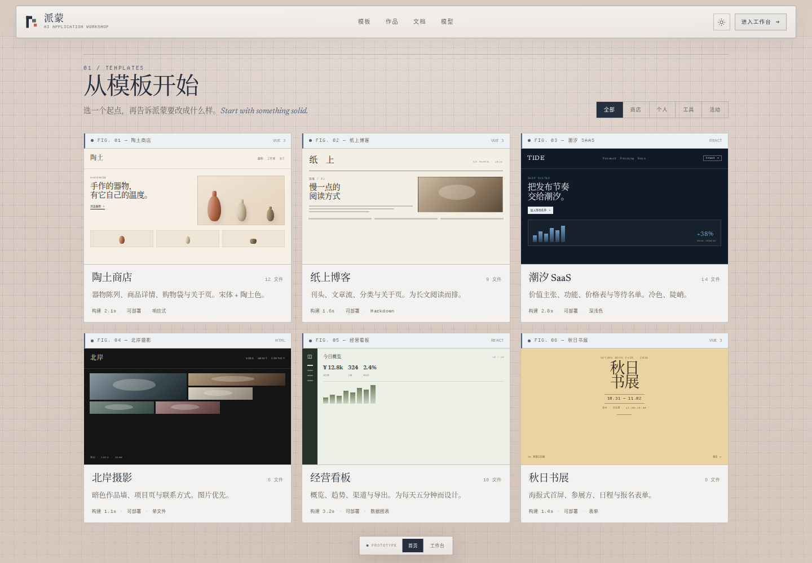
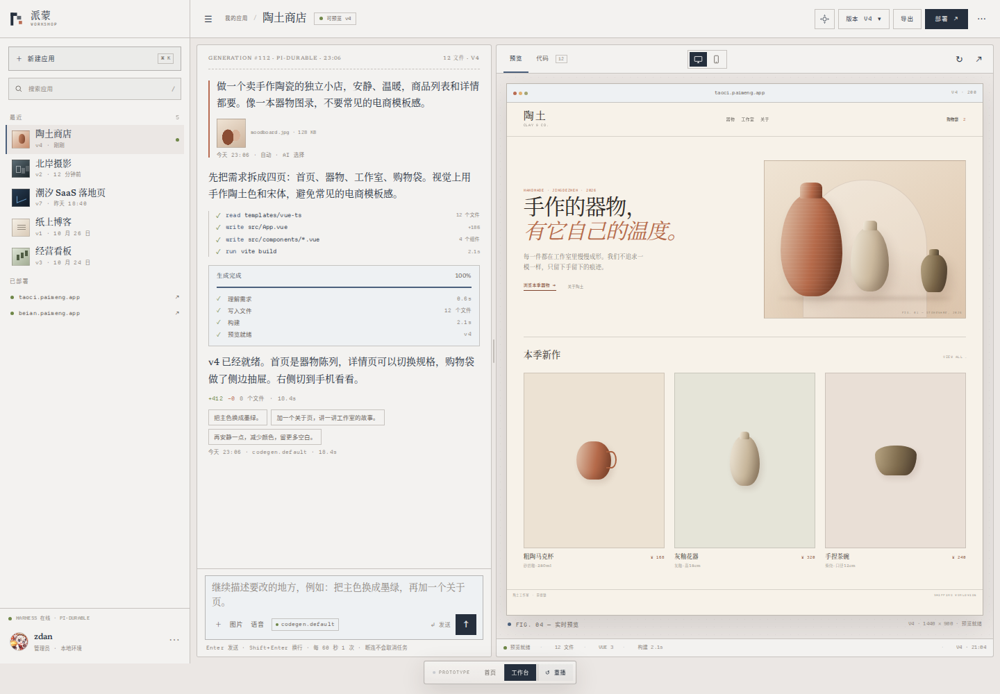
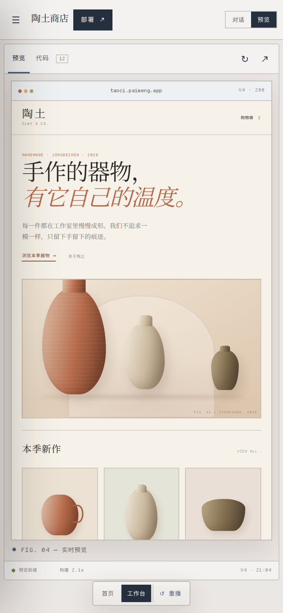

# 派蒙 AI 应用工坊 · 界面原型

**v0 的布局 × pi.dev 的视觉。** 这是一个静态、可交互的 HTML 原型，用来看界面和走流程，不是生产代码，也不调用真实模型。

## 打开

直接双击 `index.html` 即可。字体、图标、缩略图全部在本地，没有外链。

也可以起一个本地静态服务器：

```bash
cd docs/prototypes/deprecated/v0-pi
python3 -m http.server 8000
# http://127.0.0.1:8000
```

## 01 首页



- v0 的中心式创建入口：一句提示词、一个足够大的输入框、技术栈页签、建议 chips。
- pi.dev 的版面语言：羊皮纸底 + 细网格、衬线标题、斜体英文点缀、等宽小标签、细线面板。
- 输入框下方是「从模板开始」和「别人已经做出来的」两段；模板缩略图全部用 CSS 画，没有图片素材。



点击模板卡右下角的「使用模板」会把提示词填回输入框；右上角的分类可以筛选。

## 02 工作台



- v0 的工作台骨架：274px 应用侧栏、顶部项目栏、对话 + 预览分栏、Preview / Code 页签、部署按钮。
- 对话区刻意保留产品现在的 pi 终端风格（左侧色条的用户消息、工具调用、构建时间线），没有改成 v0 的对话气泡。
- 预览区是一个手工搭的陶土商店示例，带浏览器外框、桌面 / 手机切换、figure 编号和实时状态栏。
- 「版本」打开右侧版本抽屉；「部署」打开部署成功弹窗；两者都对应当前产品的真实流程。

## 03 移动端



- 侧栏变成抽屉，主区域用「对话 / 预览」切换；预览自动进入窄屏布局。
- 原型导航栏缩成底部一条，不遮挡面板。

## 可以点的部分

| 操作 | 会发生什么 |
| --- | --- |
| 首页输入 / 选技术栈 / 点 chip / 点模板 | 填入提示词，计数更新 |
| 点「生成应用」 | 切到工作台，播放约 3.2s 的生成时间线：理解需求 → 写入文件 → 构建 → 预览就绪 |
| 生成中按 `Esc` | 停止演示，恢复可编辑状态 |
| 工作台底部「↺ 重播」 | 用上一次的提示词重新播放生成 |
| 对话里发送「把主色换成墨绿」 | 预览真的换成绿色主题，并给出一条修改回执 |
| 预览 / 代码页签 | 切换实时预览和 Vue SFC 源码视图 |
| 桌面 / 手机按钮 | 切换预览画布宽度，示例站点按容器宽度重排 |
| 版本抽屉里点「使用这一版本」 | 标记当前版本、更新 v3/v2/v1 标签，预览换成对应的示意状态 |
| 部署 / 复制 | 打开部署成功弹窗，复制演示链接并提示 |
| 右上角主题按钮 | 浅色 ↔ 深色；两种主题都按 pi.dev 的 token 调过 |
| 搜索 / 新应用 / 侧栏收起 | 侧栏应用过滤、返回首页、桌面收起侧栏 |

## 设计映射

| 元素 | 来源 |
| --- | --- |
| 顶部导航、居中大标题、提示词框、建议 chips、模板三列卡 | v0 首页 |
| 左侧应用列表、项目栏、对话 + 预览分栏、Preview / Code、Publish | v0 工作台 |
| 羊皮纸网格、Plantin 式衬线、等宽标签、figure 编号、细线、暗色主题 | pi.dev |
| 工具调用、构建进度、版本抽屉、部署成功 | 当前派蒙产品（pi-durable 流程） |

设计 token、字体、网格、卡片、工作台和示例站点都在 `style.css` 里按区块分好，改一套变量就能换主题。

## 已知边界

- 生成过程是前端定时器演示，不是真实模型输出；预览固定为「陶土商店」样例，换提示词不会生成另一套页面。
- 对话修改只实现了一个彩蛋：「墨绿 / 绿色」会把示例站换色；其他输入只给通用的原型反馈。
- 版本切换只改预览的示意状态和标签，不会真的重建工程；部署、复制、导出都是演示。
- 没有做登录 / 注册、管理端、模型管理、真实作品广场、图片和语音上传。
- 页面底部的 `PROTOTYPE` 条是评审工具，不属于产品 UI；它被放在工作台底部的一段留白里，避免盖住面板。

## 字体与素材

- **Newsreader**（标题衬线，SIL OFL 1.1）与 **JetBrains Mono**（代码，SIL OFL 1.1）自托管在 `fonts/`，避免外网依赖。
- **Departure Mono**（等宽小标签，仓库标注 MIT）来自 [rektdeckard/departure-mono](https://github.com/rektdeckard/departure-mono)。
- 中文使用系统字体：Noto Serif CJK SC / Songti SC / SimSun；没有打包体积很大的 CJK 字体。
- pi.dev 使用的 Plantin 是商用字体，**没有**复制；这里用 Newsreader 替代。项目里的方块 P 标记是本原型画的，不是 pi 的 logo。
- 侧栏头像来自项目已有的 `public/paimeng.png`，缩到 96px 使用。派蒙角色素材的对外发布授权需要另行确认。

完整的字体声明见 `fonts/README.md`。

## 验证

- 用 Playwright（Chromium）在 1440×1000 和 390×844 下截图，无 console error。
- 已走通：筛选 / 填模板 → 生成 → 构建中 → 预览就绪；代码页签；版本 v3 切换后的标签与预览；部署弹窗与复制；深浅主题；移动端面板切换、侧栏抽屉、导航抽屉。
- `node --check app.js` 通过。
- 截图里的时间、版本号、部署 URL、文件数都是演示数据。

截图：`preview-home.png`、`preview-templates.png`、`preview-workspace.png`、`preview-mobile.png`。

## 文件

```text
v0-pi/
├── index.html                 # 两个界面 + 版本抽屉 / 部署弹窗
├── style.css                  # token、首页、工作台、示例站点、响应式
├── app.js                     # 切屏、生成演示、版本 / 预览 / 主题、移动端
├── preview-*.png              # 取自本原型的截图
├── assets/paimeng-avatar.png  # 侧栏头像（来自 public/paimeng.png）
└── fonts/                     # 自托管字体与许可说明
```

## 如果继续落地

1. 保留现有对话、版本、部署和 pi-durable 逻辑，只换壳：工作台的对话列已经是终端风格，直接复用；预览面板外面包一层浏览器 chrome 即可。
2. 把 `style.css` 的 `:root` token 抄进应用主题，先做浅色，再补 `data-theme="dark"`。
3. 版本抽屉的 430px 宽度、版本行结构和「使用这一版本」的分组，已经能对应当前 `version-panel` 的信息层级。
4. 不要把这套生成定时器带进生产；它只是让评审在 3 秒内看到完整状态变化。
5. 首页的模板缩略图是 CSS 场景，接入真实应用封面后记得保留 figure caption 和等宽标签，视觉语言才不会散。
