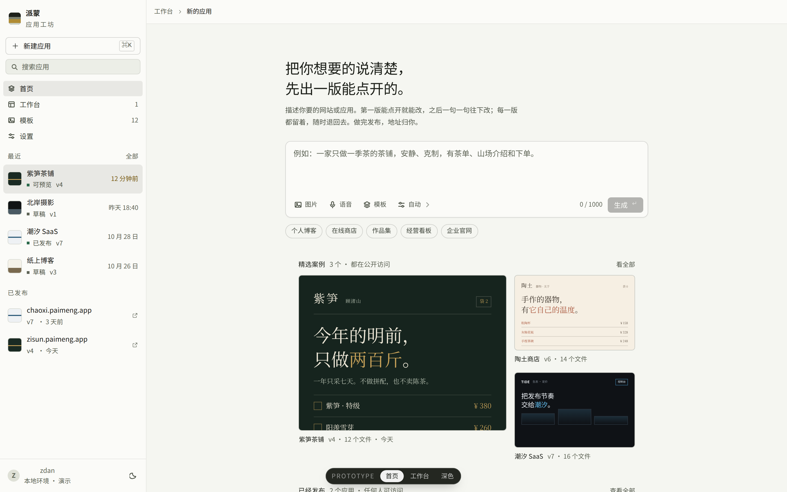
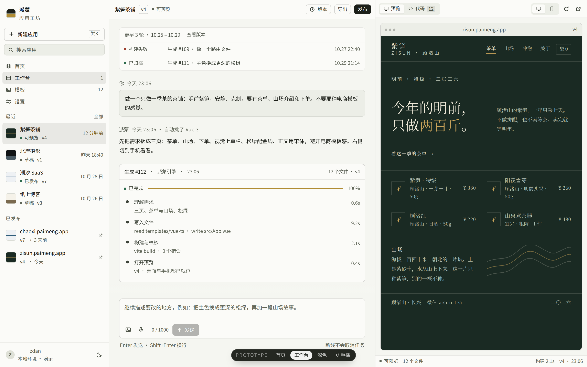
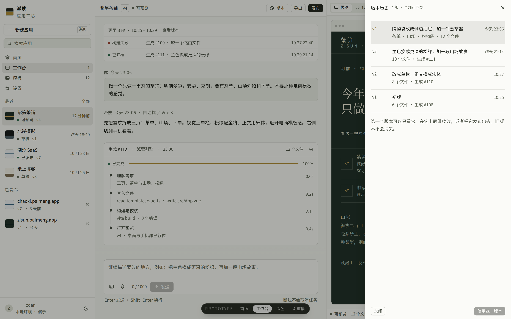
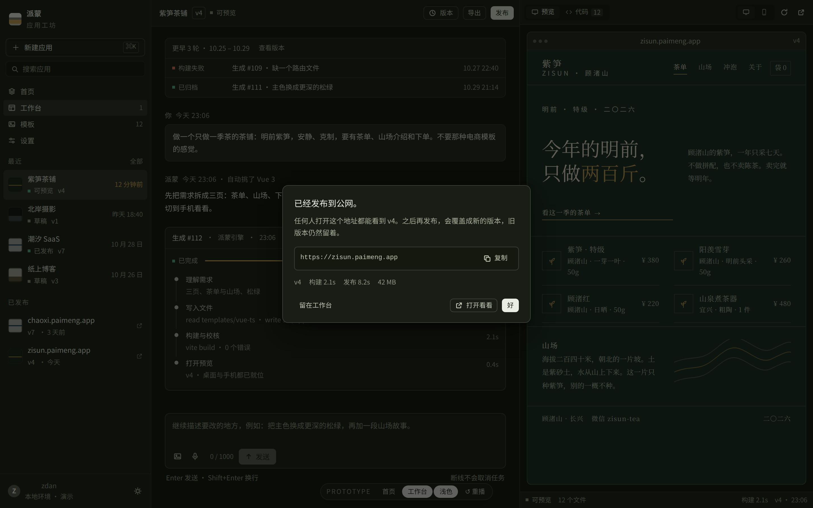
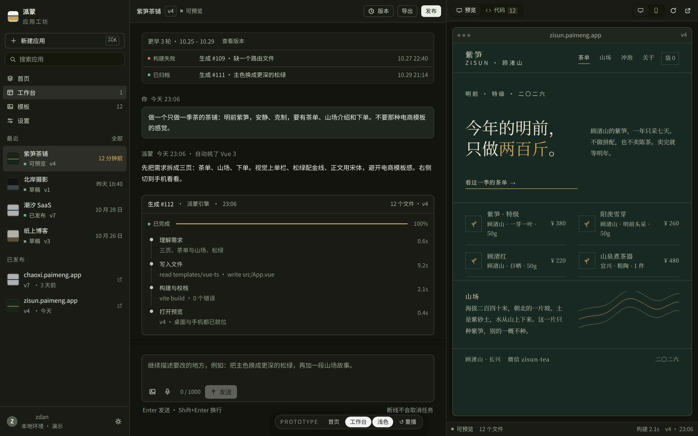
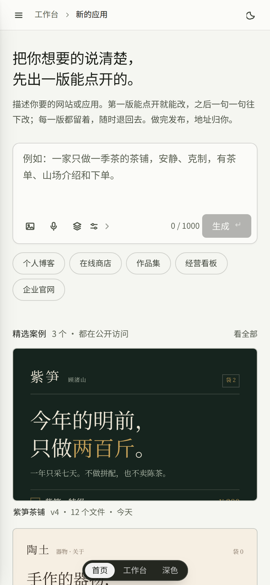

# 派蒙 · 应用工坊 · workbench

**当前方向的界面原型。** 静态 HTML/CSS/JS，两个界面（首页、工作台）加移动端，明暗双主题。不调用真实模型，不连数据库，不真的构建或部署。

后端能力、接口缺口及动态工作分组的接入草图见 [后端差异分析](backend-gap-analysis.md)。其中明确区分现有实现与尚未实现的架构提案。

## 打开

直接双击 `index.html`。没有外链、没有网络请求，字体用系统中文字体栈。

或者起一个静态服务器：

```bash
cd docs/prototypes/in-progress/workbench
python3 -m http.server 8000
# http://127.0.0.1:8000
```

## 它长什么样



首页是三栏工具界面：左边侧栏（标记、新建、搜索、导航、最近、已发布、用户与主题），中间 664px 内容列，右边空着。内容列从上到下是——两行标题、一句说明、需求输入框、建议 chips、「精选案例」三帧、已发布列表、模板列表。

**精选案例不是图。** 三帧迷你站点用容器查询单位（`cqw`）把真实页面等比缩进框里，文字、留白、颜色都跟着框走，改宽度不糊。



工作台是四段式：顶栏（应用名、版次、状态、版本、导出、发布）· 对话列 664px · 检视栏 520px。对话里依次是历史块（含一条**构建失败**的记录）、需求、计划、**生成卡片**（四个阶段 + 进度 + 用时）、结果与后续建议。检视栏是预览 / 代码两个页签，底下一条状态栏。

预览真的能点：点茶单里任一条目会加进购物袋，右上角计数变成 1，侧边抽屉列出条目和合计。设备切换不是缩放——检视栏是容器查询的作用域，桌面（宽于 430px）时站点是双栏版式，手机（375px）时重排成单栏。



版本抽屉：v4–v1，每行是「改了什么 + 文件数 + 生成编号」，选中后可以「使用这一版本」。





深色主题是独立调过的第二套值：底 `#11140e`、面板 `#191d16`、黄铜换成 `#d6ab52`。不是把浅色反相。



移动端：侧栏变抽屉，顶栏只剩菜单、应用名、状态点、预览、发布；预览改成全屏覆盖，可以被关掉。

## 可以点的部分

| 操作 | 会发生什么 |
| --- | --- |
| 首页输入框输入 | 计数更新，「生成」按钮解锁 |
| 技术栈菜单（输入框底部「自动 ▾」）| 选中后按钮上的字变成「Vue 3」这类具体说法 |
| 点建议 chip / 模板行 | 把描述填进输入框 |
| 点「生成」 | 切到工作台，重播一次生成：四个阶段逐条走完（时间轴按真实的 12.3 秒四倍速快进，印出来的耗时不变），进度条推进，预览蒙层盖住旧画面，完成后把版次改成 v1 |
| 生成中按 `Esc` | 停止演示 |
| 工作台底部或对话里的建议 | 追加一条修改，改完提示「旧的 v4 还在版本里」；说「墨绿」会把预览换成深绿版本 |
| 「版本」 | 右侧抽屉：v4–v1，选中后可以「使用这一版本」 |
| 「发布」 | 发布成功弹窗，带地址与构建/发布用时，可复制 |
| 预览 / 代码页签 | 切换实时预览和 Vue SFC 源码 |
| 桌面 / 手机按钮 | 375px 与桌面宽度是两套版式：站点真的重排，不是缩放 |
| 预览里点茶单条目 / 点「袋 N」 | 加进购物袋，抽屉列出条目与合计 |
| 技术栈菜单 | 输入框底部的「自动」菜单，选完回到输入框 |
| 右上角主题按钮 / 按 `T` | 浅色 ↔ 深色，记在 localStorage |
| 按 `R` | 重新加载预览（带蒙层） |
| `⌘K` / `Ctrl+K` | 回到首页并聚焦输入框 |
| `Tab` / `Enter` | 侧栏应用、首页行、案例卡都可聚焦，回车打开 |
| 原型条「↺ 重播」 | 用当前输入重播一遍生成 |

## 设计约束

要点（token 尚未抽出，暂以本节为准）：

- 苔石灰中性色阶（色相 78，饱和度 5–12%）+ 单一黄铜强调色；
- 分层用 1px 发丝线，不用阴影；只有浮层、预览框和聚焦光晕抬起来；
- 没有展示字体，层级只由字号 / 字重 / 行距 / 字距做；
- 最小字号 11px 且只给功能性微文本，正文段不低于 12px；
- 状态永远是 5px 方块 + 一个词，不做彩色胶囊。

## 已知边界

- 生成过程是前端定时器，不是真实模型；四个阶段的用时是写死的演示值。
- 只有一个预览样例（紫笋茶铺）。换描述不会生成另一个站；对话里的「墨绿」彩蛋只是切一个色板变量。
- 版本抽屉只改标签与提示，不会真的重建工程；发布、导出、复制都是演示。
- 没有登录、管理端、模型配置、真实作品广场、图片与语音上传。
- 侧栏「模板 / 设置」导航、模板页、全部列表页不在本原型范围内，点了会提示。
- 底部 `PROTOTYPE` 条是评审工具，不属于产品 UI。
- 页面里所有应用名、版次、网址、文件数、用时均为虚构演示数据。

## 文件

```text
workbench/
├── index.html          # 首页 + 工作台 + 抽屉 / 弹窗 / 原型条
├── style.css           # token、外壳、组件、预览与演示站、响应式
├── app.js              # 视图切换、生成演示、对话、版本、主题、快捷键
├── preview-*.png       # 6 张截图（Playwright Chromium 1440×900 / 390×844，2×）
└── README.md
```

## 截图来源

`preview-*.png` 全部由本目录的 `index.html` 在 Chromium 里现场截取（1440×900 与 390×844，deviceScaleFactor 2），没有合成、没有外部素材。界面里的迷你站点是用 CSS 画的，不是截图。

## 验证

- Playwright（Chromium）在 1440×900 与 390×844 下截图，无 console error、无 pageerror。
- 走过：输入 → 生成（四阶段完整动画）→ 预览就绪；对话修改 → 蒙层 → 新版本提示；版本抽屉选中 → 使用这一版本；发布弹窗 → 复制；预览/代码切换；桌面/手机切换；明暗切换；移动端侧栏抽屉与全屏预览。
- `node --check app.js` 通过。
- `impeccable detect` 扫过 `index.html` 与 `style.css`：剩余两条 `cramped-padding` 为有意为之——顶栏子元素垂直居中于内边距中（启发式把撑满行的 flex 间隔器读成贴边），预览视口按设计满幅铺满（预览内容不应被内边距侵入）。
- 一次独立评审（fresh context）给出的处置是 `fix`，六条材料性问题全部修掉：读数不再互相矛盾、预览真的能点、桌面/手机是两套版式、`taoci` 残留改名、首页从三张等宽卡改成 1+2 的不对称栏、侧栏可用键盘进入。评审同时发现 `[data-w]` 选择器误匹配了预览框本身，导致在预览里点任何东西都会触发设备切换——已修。
