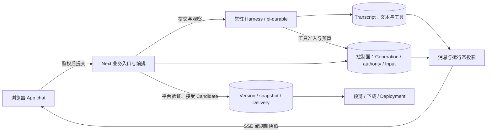

# Workbench 原型与现有后端：能力差异与接入草图

> 状态：架构对比与候选接入方案，尚未实现；不是已接受的 ADR。核对日期：2026-10-30；代码基线：`c1d8467`。原型是工作区中未提交的 `docs/prototypes/in-progress/workbench/`。
>
> 范围：对照 workbench 首页、工作台、版本/部署浮层与移动端，重点回答能否用通用组件展示动态工作阶段。本次只写文档，不修改后端、数据库或原型交互。

## 1. 结论与阅读方式

现有系统可以承接 workbench 的主要流程；布局、配色、主题、抽屉和设备切换主要是前端接入工作。**动态的语义工作分组是一个真实的数据契约缺口，不是把现有四段数组改成 `map()` 就完成。**

这里把三种容易混淆的概念分开：

| 概念 | 回答的问题 | 当前事实来源 | 与原型的关系 |
| --- | --- | --- | --- |
| Generation status / Generation phase | 本轮是否生成、构建、结束；能否写入/发布 | 产品库控制面 | 保留；不能拿内部 `editing/checking/publishing/finished` 当用户语义阶段 |
| 工具、构建与用量记录 | 实际执行过什么、结果与已知耗时是什么 | Harness Transcript、工具结果、`generation_step` / `generation_attempt` | 已存在，可作为大卡内的证据 |
| Work activity（工作活动，本文提案） | 这些说明、工具和产物属于哪一个工作目标 | 当前没有显式契约 | 需要补；标题、数量、顺序来自任务，而非固定页面枚举 |

下文使用“已有 / 部分支持 / 缺口 / 纯前端 / 内容或基础设施”区分成本。标成“提案”的类型、模块、接口均不存在于当前实现。文档依据代码、相关测试和仓内 ADR；没有以真实模型或生产流量验证生成质量、耗时与容量。

## 2. 当前系统如何运行（Ground）

### 2.1 概览与关键概念

用户看到的是一个 App chat，跨越多次 Generation。一次 Generation 在隔离 Execution 及其 Execution conversation 中运行，Harness 保存原始 Transcript。Next 侧负责准入、业务编排和消息投影；模型/工具循环由 pi-durable 驱动。用户、助手、工具原始记录与浏览器显示气泡不是一对一关系。

有源码变化的 Generation 通过验证后，平台封存 Source snapshot，接受为 Version 和不可变 Delivery，更新当前预览指针；这叫 Publish。无源码变化的纯对话可以成功收束而不新增 Version。用户再点原型“发布”调用 `/app/deploy`，形成 Deployment 副本；当前默认是本机路径地址，公网运行还需部署配置。术语以根目录 [GLOSSARY.md](../../../../GLOSSARY.md) 为参考，已发现的文档/代码口径冲突见文末。



### 2.2 一次生成、实时显示与刷新

1. 首页 `POST /api/app/add` 创建 App、选择 Generation type 和 Template；聊天页再向 `POST /api/app/chat/gen/code` 提交消息及请求 UUID。创建 App 不等于生成已经完成。
2. 控制面取得 App 的 Write authority，创建独立 Execution。Harness 运行模型和工具，写入 `app.user`、`pi.assistant`、`pi.tool-result` 等记录。
3. `RunTranslator` 把模型/工具事件转为 AI SDK 消息流。文本、reasoning 和工具结果可从 Transcript 恢复；`data-progress`、`data-build`、`data-steer` 是瞬时提示。
4. 前端 `useChat` 接收增量，`useGenerationSync` 用运行态、持久 Input 和终态纠正显示。`AssistantParts` 分别渲染文字、折叠思考和工具卡；`BuildProgress` 是独立时间线，目前不按历史 Generation 逐张嵌入消息流。
5. 模型结束后，平台执行最终验证；可修复错误会开启同一 Generation 内的 Repair。新的输入可能使旧 Candidate 失效，回到编辑，不能假设“构建一次就结束”。
6. 成功 Publish 原子记录 Version / Delivery / 预览指针 / Generation 终态；失败、取消或 Question 则走相应草稿交接。刷新依赖服务端快照重新投影，不能靠浏览器定时器补出历史。

还需区分 SDK run 与产品 Generation：当前生成中的 `followUp` 输入经 [harnessSubmitInput](../../../src/server/durable-engine.ts#L1393) 写入当前 `task.id`，后续 SDK run 仍被同一产品 Generation 验证和收束，不是自动新建一条 Generation。空闲时普通发送或 Question 的回答才走新的准入路径。新活动卡不能按气泡数或 SDK run 数分轮。

入口和投影见 [业务路由](../../../src/app/api/[...path]/route.ts)、[durable-engine](../../../src/server/durable-engine.ts#L561)、[前端同步](../../../src/app/app/chat/[id]/use-generation-sync.ts)。

### 2.3 数据目前能证明到哪里

| 现有记录 | 可以证明 | 不能自动证明 |
| --- | --- | --- |
| Transcript 文本、reasoning、工具调用与结果 | 实际回复、工具参数/结果、调用关联 | 任意语义阶段边界、某个推理片段的准确起止时间 |
| `buildPreview` 的结果 `stages[]`、`ms`、`milestone` | 这次自检构建各阶段的已知结果/耗时，模型提供的里程碑说明 | 本轮所有业务活动的耗时，最终平台验收一定成功 |
| `data-progress` | 实时文件/构建/预览提示 | 刷新后可重放的完整活动日志；它是 `transient` |
| `generation_step` / accounts | 模型/构建账目、错误、聚合耗时、`messageId` | 完整语义阶段列表与逐内容归属；工具毫秒数可能为 `null` |
| `generation_attempt` / transition | 调用预算、可能发生的外部动作、控制面状态变化 | 用户界面上的“需求理解 / 素材收集”进度条 |
| Version 与 Delivery 指针 | 已接受源码和当前预览/下载来源 | 未接受草稿就是当前预览；每次回复必然新增 Version |

特别注意：`BuildProgress` 按阶段 `kind` 合并，多次同类构建/修复会覆盖同一行；文件计数累计 `paths.length`，不是去重后的文件数。Version 的 `fileCount` 是该版完整源码树文件数，`changedFiles` 才是相对变化。三者不应共用一个“修改 N 个文件”标签。[进度归约](../../../src/components/chat/generation-feedback.ts#L88)、[版本统计](../../../src/server/version-store.ts#L407)。

## 3. 全量差异矩阵

### 3.1 首页、侧栏与应用目录

| 原型能力 | 当前实现 | 判断与所需补充 |
| --- | --- | --- |
| 描述需求、1000 字限制、自动/指定 Vue / React / HTML | `/app/add`，现有四种 Template，自动路由 | 已有。可直接接入；显式选项映射真实 templateId |
| 我的 App、名称搜索、按更新时间排列 | `/app/my/list/page/vo` 支持 `appName`、分页、`sortField` | 已有。原型客户端筛选改为真实查询；“最近访问”没有访问记录，不能用更新时间冒充 |
| 已部署 App 列表与准确总数 | 有 `deployKey/deployUrl/deployedTime`，没有 `publishedOnly` 筛选 | 部分支持。小列表可展示已加载结果；完整分页必须在数据库过滤后再统计/分页 |
| 侧栏可预览 / 草稿 / 已部署 | `previewUrl/sourceAvailable/deployUrl` | 部分支持。可推导可用性；生成中/等待回答等运行状态还需批量摘要，不能被已部署标签覆盖 |
| 侧栏、精选中的 `v4` 与生成编号 | Version 身份是 SHA；Generation 身份是 UUID | 缺展示契约。需要稳定序号或显示标题；不能用当前分页数组下标制造长期 `vN` |
| 工作台旁的数量 `1` | 没有定义这个数字代表什么 | 若是浏览器打开数量，纯前端；若是全用户运行中 Generation 数，需要服务器聚合。先统一含义 |
| 精选案例 | 公开 `/app/good/list/page/vo`，按 `priority >= 99` 取记录 | 已有。要有真实数据；Cover 主要在 Deployment 截取，无封面时需占位 |
| 三张可缩放的迷你作品 | 原型是手写 DOM/CSS 微型页面 | 内容/前端。动态列表优先真实 Cover；若要交互式实例，单独加载隔离预览，不能当列表字段就能提供 |
| 12 个站点模板、模板页 | 当前四个 Template 是工程骨架；原型模板行只填提示词 | 内容/产品缺口。提示词预设可静态维护；可复用设计模板需要真实源码、版本与注册机制 |
| 首页图片、语音 | 聊天支持附件；上传要求 App 归属；语音转写由配置决定 | 部分支持。首页图片需先创建 App 再上传、保留草稿并交给首条输入；当前 `/app/add` 不接图片。语音可先转成文字 |
| 用户、登录、主题、导航、移动抽屉 | 已有登录/Owner 权限；原型没有完整身份流程 | 身份流需补 UI；主题与布局为前端工作，不能把演示用户名当真实用户 |

依据：[路由](../../../src/app/api/[...path]/route.ts#L24)、[应用查询](../../../src/server/business.ts#L39)、[四个 Template](../../../src/shared/templates.ts#L11)、[附件绑定](../../../src/server/attachment-store.ts#L27)。

### 3.2 工作台、版本与部署

| 原型能力 | 当前实现 | 判断与所需补充 |
| --- | --- | --- |
| 自然语言迭代、文字/思考/工具展示 | UIMessage 投影、`useChat`、`ToolCall` | 已有。应迁移原有同步逻辑到新壳，避免复制一套生命周期 |
| **任意语义阶段的大块卡片** | 固定 `BuildProgressStage`、工具明细、无 Work activity | **缺核心契约**。需要动态语义来源、稳定内容归属、可恢复读模型，详见后文 |
| 每次 Generation 的历史卡片 | accounts 有 `generationId/messageId`，当前进度在页面局部 state | 部分支持。需跨 Execution 保留关联、逐轮投影；`messageId` 只指第一条助手记录，不包含所有内容归属 |
| 阶段耗时 / 总耗时 / 百分比 | 自检构建详情可恢复部分耗时；平台构建账目有总耗时；无语义总工作量 | 部分支持。未知耗时显示“未记录”；未知总量不用百分比；12.3s 与四等分不是产品事实 |
| 失败历史、返工再构建 | accounts、工具结果、平台 Repair | 已有底层记录。新卡应分别显示失败和后续成功，不能像当前实时 reducer 那样按 stage 名覆盖第一次失败 |
| Esc / 取消 | `/app/generation/cancel` 接受 generating 和 building | 已有但原型语义需对齐。等服务端结果；取消/Publish 竞争由事务决定，已接受交付不被回滚 |
| Question / 回答、排队、插话、草稿交接 | `runtime.question/inputs/handoff`、`chat/input`、`chat/steer` | 后端已有，原型 UI 不完整。Question 不直接画红色失败；插话按结算后位置显示；回答开启新 Generation |
| 预览、设备切换、新窗口、重新载入 | 独立预览服务、iframe、当前前端设备切换 | 已有。改变视口不保证生成站点本身响应式；重新载入 iframe 不等于重新构建 |
| 预览里的茶单和购物袋 | 原型样例 JS | 属于生成 App 的业务代码。静态交互可支持；真实订单、支付、数据库服务不在当前静态部署契约内 |
| **代码页、文件树、读取文件** | 有安全文件原语、ZIP；`app/asset` 只读取图片 | **缺公开读接口**。默认按当前 Delivery 对应 Source snapshot 读；固定 sourceRef 防止树与文件跨版本 |
| 版本标题、文件数、取回、差异、缩略图 | `versions/restore/diff/thumbnail` | 主流程已有。恢复不新增 Version；忙碌需禁用；处理 `previewError` 和统计未知。无缓存截图的 Vue/React 版本当前不会即时截图，需占位 |
| 版本对应哪次生成、稳定 `vN` | 台账存 generationId，但 `AppVersion` 未返回；列表有数量上限，无 total/ordinal | 缺字段/编号决策。使用稳定序号需服务端提供且保留历史顺序，不能页面临时计算 |
| 导出 | Owner 下载 ZIP，当前交付源码优先 | 已有。下载内容必须与 Preview 对应；不读取正在写入的 Execution 充当正式导出 |
| 点“发布”出现链接 | `/app/deploy`，requestId 幂等，成功返回字符串 URL | 已有。补等待/失败/重试 UI；若保留分段用时须额外采集，不能把客户端往返时间称为构建时间 |
| `zisun.paimeng.app` | 当前 URL 是 `PREVIEW_ORIGIN/deploy/<key>/` | 基础设施缺口。先显示真实路径 URL；子域名/自定义域名另作范围 |
| 明暗主题、分栏宽度、手机全屏、快捷键 | 原型局部 JS；现有聊天已有部分布局持久化 | 纯前端。保留输入法、焦点、键盘与 iframe 状态 |

依据：[运行态与消息投影](../../../src/server/durable-engine.ts#L1169)、[取消](../../../src/server/durable-engine.ts#L1628)、[生成收束](../../../src/server/generation-lifecycle.ts#L803)、[版本类型](../../../src/shared/versioning.ts#L10)、[下载与部署](../../../src/server/business.ts#L249)、[URL](../../../src/server/artifacts.ts#L224)。

## 4. 必须保留的架构约束（Why）

下面的“原有理由”来自仓内 ADR/提交；“设计约束”是本文据此提出的接入要求，不能反过来当成新的用户禁令。

| 原有理由及证据 | 本次设计约束 |
| --- | --- |
| [ADR-0001](../../adr/0001-single-writer-authority.md)：Next 与 Harness 生命周期不同，旧共享 Workspace 和 lease 使写者身份含混 | Work activity 不能取得另一份 App 写权限；写入绑定当前 Execution / epoch。浏览器断流不等于活动或 Generation 取消 |
| [ADR-0002](../../adr/0002-immutable-delivery.md)：预览、下载、部署曾读到不同源码状态 | 代码页和导出统一解析当前 Delivery 对应 Source snapshot；活动“完成”不能切预览指针 |
| [ADR-0003](../../adr/0003-sdk-as-engine.md)：产品需要自己的副作用控制，但不应 fork SDK 循环 | 新的语义记录经宿主扩展接入；不重写模型/工具调度。平台控制面与 SDK 存储仍独立演进 |
| 提交 `b86fca1` 记录删除 `app.assistant` 展示副本，并说明常驻 Harness 与 Next 只重启一半曾导致助手回复消失 | 保留原始文本/工具的单一来源；Work activity 引用它们，不复制消息正文另存一份 |
| [词汇表](../../../../GLOSSARY.md) 与 [迁移 006](../../../migrations/006_harness_control.sql#L151) 明确 Generation phase 是内部四相位 | 新展示概念叫 Work activity；不把“素材收集”等加进控制面 phase。有限的活动生命周期和独立注释记录本身并未被禁止 |

**Preserve**：Transcript 的原始叙事、authority 与输入结算、平台验证/Publish、Delivery 一致性、现有断线与草稿交接。

**Change**：增加语义活动及内容归属的契约；读投影保留 Generation / Execution / 原始内容标识；补列表摘要和源码只读入口。

**Avoid**：前端从中文自由文本或工具名猜意图；在浏览器定时器里创建历史；把一秒保活都写成业务事件；让模型声明“完成”直接改变 Generation status。

**Risk**：语义记录与工具结果的提交顺序、跨进程观察与 SDK 重放、旧历史缺少归属、插话使单条助手气泡分段。方案必须正面处理，不能以“之后补 Map/缓存”略过。

需要说明证据边界：本次取得的是源码、仓内文档、git 历史与相关测试；没有取得远端 PR/评审讨论。Issue、外部长文系统、团队聊天、监控、错误追踪、产品分析六类源无对应可用连接，所以没有用它们证明设计动机或线上容量。归档文档仅解释历史，不能覆盖当前代码。

## 5. 动态工作分组要补的契约

### 5.1 “通用”需要同时满足什么

- 每轮可以有不同标题、不同数量，也可以没有活动；新增“素材收集”无需添加前端枚举、组件分支或数据库枚举值。
- 同名活动允许多次出现；实例 ID 不等于标题或类型。第一次构建失败、返工、第二次构建成功分别保留。
- 工作说明、工具调用、工具结果及来源清楚地归属活动；折叠后能展开原始内容，不复制另一份助手回复。
- 活动没有被可靠标注时保留普通消息和工具记录，不假造“需求理解已完成”。
- 流式、刷新、重新挂接和终态恢复使用同一投影规则。允许增量暂缺数据，但已提交活动的 ID、顺序和归属不能随刷新改变。
- 活动完成和平台验证通过分别表达。模型提供的是工作意图/总结；工具、构建、Publish 的结果由实际执行方提供。

标题可以任意不代表协议可以任意：`start/update/finish` 等生命周期操作可以固定，权限校验也必须固定；不能固定的是业务活动名、业务顺序、总数量。

### 5.2 三个层次不能混为一谈

| 可交付层次 | 示例 | 能否满足本次完整目标 |
| --- | --- | --- |
| 通用组件 | `<WorkActivityCard activity={data} />` 能画任意标题 | 只完成表现层 |
| 客观操作聚合 | 把读取、检索、写入、构建等记录折叠起来 | 可用于先期交付和旧历史兜底，但不能把读取源码直接改名为“素材收集” |
| 显式语义活动 + 证据引用 | 本轮先“梳理茶单结构”，再“挑选山场素材”，引用实际文本和工具 | 本次目标；需要新的生产、持久化、归属与读取契约 |

### 5.3 原有模型不能直接充当活动模型

`ProgressStage.kind`、`buildStageLabels` 和 `parseProgressEvent` 都是固定集合，`upsert` 用 `kind` 作为行身份。即使增加一个 `stage: string`，仍没有解释谁命名、谁结束、工具属于哪段，也不能保留同类活动的多次实例。

`AccountStep` 是模型/构建的用量账目；`GenerationPhase` 是写入/发布控制相位。它们都可以提供证据，但不应改成用户语义工作流。现有 `UIMessage.parts` 是显示投影，不是禁用区：可以扩展为新的显示数据，但必须有服务端的持久来源，不能仅往浏览器消息数组里塞一个对象就声称支持恢复。

**无需先承诺新增 `generation_phase` 表。** 应先选定新的事实是什么、由谁写、如何被原始记录定位，再决定持久载体。若要独立表，它应拥有新增的活动事实，不能镜像控制面或复制 Transcript；若存进 Transcript，也必须验证宿主安全写入、幂等和恢复能力。

## 6. 候选方案与综合草图（提案）

### 6.1 两种结构的比较

| 比较项 | A：仅投影既有 Transcript / 账目 | B：显式活动报告 → Transcript → 统一投影 |
| --- | --- | --- |
| 新增持久事实 | 无 | 只新增语义声明与其来源/时间，不复制正文、任务或构建结论 |
| 能显示什么 | 读取、写入、自检等客观记录；已有文字引用 | 按任务动态命名的工作目标及关联内容，例如“核对茶单层级”“寻找山场素材” |
| 语义从哪里来 | 固定操作分类；无法判断某次读取到底在做什么 | 模型通过受控报告说明意图；平台提供独立的执行/验证事实 |
| 历史与漏报 | 无需迁移；可读既有记录 | 新记录恢复语义；旧记录/漏报仍退回普通记录 |
| 主要复杂度 | 异类记录归属、未知数据、账目关联 | 额外报告、来源校验、提交/重放与内容边界 |
| 对用户完整要求 | 只能作为渐进交付/兜底，固定分类不能冒充任意业务阶段 | 可满足动态语义分组，但需要验证 SDK 接入与报告覆盖率 |

**推荐以 B 为主体，吸收 A 的只读历史降级和内容覆盖检查。** “需求理解 / 素材收集”是语义目标；仅把读取、写入按固定类别聚合，不能满足这个要求。B 的大卡来源是明确记录的工作声明，不是假装平台能观测模型何时真正理解了需求。

### 6.2 调用方先看用法

以下名称均为拟议接口，代码体刻意不实现。

```ts
// 调用点一：Harness 的通用 reportWork 工具，模型只传业务说明。
// invocation 由宿主从 ToolExecutionApi、持久绑定和真实 callId 构造，不能由模型伪造。
const receipt = await reportWork(
  { op: 'open', title: '寻找山场素材', intent: '选取可使用的山地照片与来源' },
  invocation,
);
// 模型随后正常调用现有工具，结束时报告；这不是平台验收成功。
await reportWork(
  { op: 'close', activityId: receipt.activityId, outcome: 'reported-done', summary: '已确定素材来源' },
  closingInvocation,
);

// 调用点二：durable-engine 的实时与刷新读取，共用一个投影。
const work = projectWork(nativeEvidence, productFacts, liveReply);
// SSE 发送已提交视图的修订；runtime / 历史端点读取同一规则的快照。

// 调用点三：工作台只渲染数据，不认识“素材收集”等业务名。
<GenerationWorkCard view={work} renderContent={renderSourceContent} />
```

大卡内部按 `view.items` 顺序画输入、工作活动和未分类内容，活动折叠不包含输入项。`renderSourceContent` 是共用的文本/工具渲染适配器，不由页面按工具名猜分组。被活动消费的原始内容不再在外面重复渲染；最终回复未归组时保留原位。

建议在当前 `app/chat/runtime` 增加可选 `work` 视图；历史大卡按需调用拟议 `GET /api/app/generation/work?appId=&generationId=`，不要初次打开就为全部历史逐条请求。服务端先验证读取权限及 Generation 属于该 App，再按 Execution 绑定读取证据，不接受客户端指定 conversationId。新字段/新端点都不作为已有能力记入差异矩阵。

### 6.3 数据与接口草图

```ts
type Opaque<T, Name extends string> = T & { readonly __brand: Name };
type ActivityId = Opaque<string, 'ActivityId'>;
type ContentRef = Readonly<{
  conversationId: number;
  entryId: number;
  blockOrdinal: number; // 原生assistant内容块位置，不是UIMessage.parts下标
}>;
// 宿主构造的能力对象，封装Execution绑定、callId、时钟和Session提交；不暴露HTTP/SDK类型。
type WorkInvocation = Opaque<object, 'WorkInvocation'>;
type WorkCommand =
  | { op: 'open'; title: string; intent: string }
  | { op: 'close'; activityId: ActivityId;
      outcome: 'reported-done' | 'reported-blocked'; summary: string };
type WorkReceipt = { activityId: ActivityId; reportEntryId: number };
// 仅作新增语义声明的持久载荷；以下身份/时间由宿主提供，模型不能传入。
type WorkReport = Readonly<{
  schema: 1;
  generationId: string;
  executionId: string;
  source: { callId: string; assistantEntryId: number };
  recordedAt: number;
  clockSegment: string;
  command: WorkCommand;
}>;
type ActivityWindow =
  | { kind: 'recorded'; ms: number; basis: 'report-window' }
  | { kind: 'unknown' };
type WorkActivity = Readonly<{
  id: ActivityId;
  title: string; // 业务标题没有固定枚举
  intent: string;
  source: 'model-report';
  state: 'reported-open' | 'reported-done' | 'reported-blocked'
    | 'interrupted' | 'unknown';
  content: readonly ContentRef[];
  summary: string | null;
  window: ActivityWindow;
}>;
type WorkItem =
  | { kind: 'input'; content: readonly ContentRef[] }
  | { kind: 'activity'; activity: WorkActivity }
  | { kind: 'unclassified'; content: readonly ContentRef[] };
type WorkView = Readonly<{
  generationId: string;
  revision: string;
  items: readonly WorkItem[];
  overall: GenerationStatus; // 复用产品控制面，不让模型设置
  awaitingAnswer: boolean;
  verification: readonly VerificationFact[]; // 独立的实际执行证据
  pendingReply: LiveReply | null; // 未提交增量，明确标为临时，不伪造永久归属
}>;

async function reportWork(
  command: WorkCommand, invocation: WorkInvocation,
): Promise<WorkReceipt> {
  // TODO: 验证真实绑定/epoch与工具边界；以(executionId, callId)原子去重并追加报告。
  //       同键异参冲突；取宿主时钟；不改Generation、输入结算、源码或Delivery。
  throw new Error('not implemented');
}

function projectWork(
  evidence: WorkEvidence, facts: ProductFacts, live: LiveReply | null,
): WorkView {
  // TODO: 按原生条目顺序归属；工具结果按调用身份回填；保持输入位置；
  //       从产品事实取得整体结果；输出每个可展示内容块恰好一次。
  throw new Error('not implemented');
}
```

`WorkEvidence` 是源适配器解码后的、保留 Execution / conversation / entry / 原生块身份的记录；`ProductFacts` 是既有状态、Question 与账目快照。`VerificationFact` 按真实 attempt/step 或自检工具调用身份区分多次检查，每个已知耗时携带来源与时钟口径，缺失或无法关联时为 unknown，不按序数凑配。`LiveReply` 仅放未提交文字/思考。它们是拟议模块内部的域数据，不能直接取当前合并后的 `UIMessage.parts` 冒充。实际 JSON、SDK 对象和 schema 版本在适配边界解析，投影内部只处理验证后的类型。

公共面只做“报告一件工作”和“把证据投影成界面”两件事。它隐藏去重、来源、边界、恢复与归属；不向业务页暴露活动 CRUD、事件拼接和多库同步规则。这是所选方案的接口深度，而不仅是函数数量少。

### 6.4 模块与唯一事实来源

| 模块（路径均为提案，除注明现有者） | 职责 |
| --- | --- |
| `src/shared/work-activity.ts` | 视图/报告协议与边界校验；活动业务名是文本，生命周期操作有有限协议 |
| `src/server/work-activity.ts` | `reportWork` / `projectWork`，内部规则与一致性检查；不存第二份助手正文 |
| `src/server/durable/harness-server.ts`（现有） | 注册 model-only、sequential 的报告工具；构造可信调用上下文，经既有预算与执行准入 |
| Harness Transcript 新增 `app.work.v1` 条目（提案 kind） | 唯一新增的活动声明源，包含宿主绑定、来源 callId、宿主时间和命令；省略 model 字段，不污染模型历史正文 |
| `src/server/durable-engine.ts`（现有） | 保留原生身份与新条目，实时/刷新/历史都调用同一投影；不能先合并气泡再猜活动 |
| `src/components/chat/generation-work-card.tsx` | 大卡与活动行、折叠和未分类内容；复用原文本/工具渲染能力；不内置业务阶段列表 |

条目写入优先使用当前 SDK 的 Session / ToolExecutionApi 提交能力，不 fork 调度循环。当前普通 `/entries` 会排队并等待写入落地，不能由正在执行的工具同步回调并等待，以免等自己结束。`HookApi` 也没有 `commit()`；具体适配只能使用已确认存在的宿主能力。第一步应验证这些边界，而不是直接把草图当作可复制实现。

读取也必须改源适配：目前 Next 的 `transcriptEntrySchema` 及 Harness `/messages` 输出没有完整保留 conversation / task 身份。应从 `/runtime` 的原生记录及已授权 Execution 关联中解码，或明确扩展相应 schema，再进入气泡合并与活动投影。仅给 `RunTranslator` 增加 `entry_appended` 分支不够；事件类型存在也不证明断流后的完整回放和 safe 工具恢复已经验证。[当前转录解析](../../../src/server/durable-engine.ts#L1152)、[Harness 读取入口](../../../src/server/durable/harness-server.ts#L937)。

### 6.5 首版必须明确的行为

| 边界 | 推荐规则 |
| --- | --- |
| 谁命名 | 模型通过一个通用报告工具给标题/意图；“开始写入”不自动等于“需求已理解”；平台检查保留独立来源 |
| 生效位置 | 报告必须是该 assistant 中唯一工具调用；`open` 从其提交后的后续完整 assistant 开始，`close` 所在条目仍属于旧活动。混合工具/多个报告拒绝，但不丢原文 |
| 内容归属 | 原生块稳定引用；结果随原调用归组，不按结果到达时“当前活动”归组。多个普通工具可并行，首版只允许一个活动焦点，不做并行语义 DAG |
| 插话与后续输入 | 真正进入 Transcript 的新输入结束旧展示范围，输入留在原位置；后续先未分类再重新报告。accepted/placed 队列不算已完成工作。Repair / followUp 不按 SDK run 强造新 Generation |
| 去重与崩溃 | 以真实 `(executionId, callId)` 去重，在同一次执行库提交中检查并追加。报告已提交但工具结果缺失时，重放返回原 receipt；不能靠进程 Map 维持唯一性 |
| 实时与刷新 | SSE 只发送已提交视图及修订；完整快照和实时走同一投影。未提交 token 单列临时区，提交后归属；不承诺它在刷新前后仍有同一个临时下标 |
| 结束、取消、Question | 产品终态只收束尚未完成的活动，不把旧成功证据洗掉；未 close 的显示中断/未知。Question 显示等待回答；回答的新 Generation 不复用旧活动 ID |
| 迟到记录 | 产品库准入与执行库提交没有跨库原子事务；已准入的展示声明可能迟到，只能留在原 Execution，不能把已取消/已发布的 Generation 改回运行中 |
| 时间与进度 | 宿主记录的是声明窗口，含等待，并非“理解用了几秒”；缺 close、跨时钟段或缺证据时 unknown。实际构建 `ms` 单独显示；未知总量不显示百分比，不把工具耗时之和当墙钟 |
| 漏报/旧记录 | 保留未分类文字、工具明细及已知构建详情，不回填写“需求理解”等历史，不为这项增强额外跑总结模型 |
| 来源校验 | 模型不能传 appId/epoch/origin/时间；绑定由宿主解析。新增保留命名空间/内部写路径不得经浏览器泛代理伪造；验证真实调用来源，不信 `data.origin` 自称平台 |
| 部署兼容 | 新工具/条目需要协议或能力协商，沿用现有 `harnessProtocol` 守卫并协同更新常驻服务；旧后端/未知 schema 保留原聊天，不能静默把活动当作不存在 |

**来源保护属于新记录可信性的一部分。** 当前浏览器 durable 代理可转发 POST，`/entries` 接受应用 kind；Harness HTTP 服务也没有现成的服务端认证。不能仅新增 `app.work.v1` 并相信其载荷。实施时应保留正常读/调试能力，针对新保留命名空间和内部写接口收紧代理/解析，并用明确网络边界或服务端凭据证明内部调用；只有 Next 的 Owner 校验不足以证明条目由报告工具产生。本文件不把“全面禁掉所有调试写接口”顺带定为既定决策。

### 6.6 综合决策（Synthesis decision）

以候选 B 的“受控语义声明 + 原生 Transcript + 统一投影”为基座：它提供 A 缺少的真实语义来源，同时不复制助手正文、不替代产品控制面。采用 A 的两点：旧记录只读降级，以及每个可展示原始内容块必须归到一个活动或未分类区的覆盖检查。

不采用 A 的固定 `WorkClass` 作为完整语义接口，也不按第 k 条账目与第 k 个 SDK run 猜测构建对应关系。没有可靠关联就单列验证事实。不采纳 B 中一刀切禁用全部 proxy POST 的广泛改造，改为限定本次新增语义命名空间与受控入口的来源要求。

Arena 以六项标准分别打分（每项 1–5）；数值是静态设计评估，不是运行验收：

| 标准 | 父代理 A | 父代理 B | 独立评审 A | 独立评审 B |
| --- | ---: | ---: | ---: | ---: |
| 现有契约与权威边界一致性 | 4 | 4 | 5 | 4 |
| 开放语义、动态分组与归属 | 2 | 4 | 3 | 4 |
| 流式/恢复/取消/重放安全 | 3 | 3 | 4 | 3 |
| 接口深度与隐藏复杂度 | 3 | 4 | 4 | 5 |
| 需求覆盖与改动克制 | 4 | 4 | 5 | 4 |
| 事实与提案的可审计性 | 4 | 5 | 5 | 5 |
| 合计 | 20 | 24 | 26 | 25 |

父代理与独立评审均选择 B 为基座。评审的 A 总分更高，体现了它成本低、边界保守；但总分不能替代“支持开放业务语义”这项必要条件。父代理采纳评审对 B 恢复证据不足的意见，将该项从初评 4 分降为 3 分，并把隔离验证设为后续实施门槛。

候选 runner 分别使用 DeepSeek v4.1 Flash 与 GPT-6.1，独立 cross-judge 使用 GLM-5.3 Flash。两个候选均完整返回，无候选退出；本节记录综合取舍，未将“评审推荐”写成“功能已通过验证”。

接受的取舍：报告会占用模型/工具预算；首版按完整 assistant 条目归属、单活动焦点、流式未提交内容暂不永久归组。这些限制换取明确的刷新/恢复规则和可验证的最小实现，不宣称支持任意并行工作流。

这里的成本不能轻描淡写：当前模型调用预算为 24 次，报告若必须单独调用，多个活动的 open/close 会占掉实际生成和 Repair 的轮次。接入验证必须测量这种开销；若不能在现有预算内完成代表性需求，应重新比较报告粒度或结构，而不是静默加大预算、缩减验收或将漏报伪造成成功。

仍然可竞争的替代方案是“产品库独立追加式活动事件账本，只存语义元数据并引用原文”。它没有天然违反 ADR，但需增加宿主写入、幂等、跨库关系与恢复设计。本期优先验证已有 Transcript 的扩展能力；若验证失败，应回到方案比较，不在错误适配上堆同步补丁。纯前端正则分类和事后模型补造阶段均不满足实时、可追溯的完整目标。

**下一实现步**：用隔离存储与假模型验证一个报告的可信写入、重复重放、内容边界和同源投影；通过后再接大卡 UI。本次只交付草图，未运行该验证。

## 7. 配套读接口草图与落地边界（提案）

这部分只补原型明确需要的数据，不把目录、源码、阶段和发布塞进一个巨型“工作台万能接口”。

### 7.1 调用方先行

```ts
// 侧栏：一次查询获得本页 App 的摘要；已部署条件在数据库分页之前应用。
const page = await readMyAppCatalog(owner, {
  page: 1, pageSize: 12, name: search, deployedOnly: true,
});

// 代码页：先选定不可变源码引用，之后的读取都固定到它。
const tree = await readAppSource(owner, { appId });
if (tree.kind === 'available') {
  const file = await readAppSource(owner, {
    appId, sourceRef: tree.sourceRef, path: 'src/App.vue',
  });
}
```

建议给既有私有应用列表增加摘要字段和 `deployedOnly` 条件；公开精选保持自己的公开 DTO，不泄漏私有错误、队列或源码。建议新增 `GET /api/app/source/tree` 与 `GET /api/app/source`；上述函数是服务端域接口，HTTP 解析与权限验证放在边界。

### 7.2 类型与签名

```ts
// 以下是接口草图，不是可直接复制进项目的完成代码。
type SourceRef = string & { readonly __sourceRef: unique symbol };
type Owner = { readonly id: string }; // 实现时复用真实鉴权身份，不从请求体信任该值。
type CatalogQuery = {
  page: number;
  pageSize: number;
  name: string;
  deployedOnly: boolean;
};
type AppCatalogItem = {
  appId: string;
  name: string;
  previewUrl: string | null;
  deployUrl: string | null;
  currentPreviewVersion: { id: string; title: string } | null;
  activeGeneration: { id: string; status: GenerationStatus } | null;
};
type AppCatalogPage = {
  records: readonly AppCatalogItem[];
  total: number;
};
type SourceTreeQuery = { appId: string };
type SourceFileQuery = { appId: string; sourceRef: SourceRef; path: string };
type SourceTree =
  | { kind: 'unavailable'; reason: string }
  | { kind: 'available'; sourceRef: SourceRef; files: readonly string[] };
type SourceFile =
  | { kind: 'unavailable'; reason: string }
  | { kind: 'text'; sourceRef: SourceRef; path: string; content: string };

async function readMyAppCatalog(
  owner: Owner, query: CatalogQuery,
): Promise<AppCatalogPage> {
  // TODO: 先Owner/筛选/分页，再批量读取本页控制面与当前Delivery版本摘要；
  //       不从最新Version推断当前Preview，不逐卡轮询、不逐项读取完整Git树。
  throw new Error('not implemented');
}

function readAppSource(owner: Owner, query: SourceTreeQuery): Promise<SourceTree>;
function readAppSource(owner: Owner, query: SourceFileQuery): Promise<SourceFile>;
async function readAppSource(
  owner: Owner, query: SourceTreeQuery | SourceFileQuery,
): Promise<SourceTree | SourceFile> {
  // TODO: 验证Owner -> 固定Source snapshot -> 路径/类型/大小校验 -> 返回内容；
  //       sourceRef是服务端可校验的不透明引用，不是客户端指定的磁盘绝对路径。
  throw new Error('not implemented');
}
```

`GenerationStatus` 复用当前公共类型；树查询与单文件查询分别具有精确返回类型。一个门面隐藏 Delivery / Source snapshot / legacy 的解析细节，调用方不需要理解磁盘目录。

源码读取不应把 `workspace(app)` 当成默认路径：失败后 Draft 与旧 Preview 可以同时存在。已有 Delivery 失效就报错，不能静默回退；没有稳定 Delivery 的 legacy App 要么先在既有维护写路径物化交付，要么明确返回不可浏览，不在 GET 读取中偷偷封存/建版本。文本大小、目录排除和软链接规则复用 `workspace.ts`，不要再造一套弱校验。

若必须保留 `vN`，应有稳定分配和历史回填契约；本草图默认先用标题/时间，不引入序号迁移。部署成功接口也可先继续返回 URL；只有保留“构建/复制/截图分别用时”的产品需求时才采集分段元数据，不把往返秒表冒充阶段计时。

## 8. 接入次序与范围

| 顺序 | 交付 | 保持的边界 | 完成判据 |
| --- | --- | --- | --- |
| 1 | workbench 壳接真实创建、聊天、预览、版本、部署 | 复用现有消息同步与控制逻辑；界面不复制另一套任务状态机 | 登录/空态/失败/Question/取消/生成中继续输入均能走通；演示 URL、耗时与固定数字退出产品界面 |
| 2 | 工作记录统一读投影，明确 Generation / Execution / 内容身份 | 先解决流式与刷新一致性；旧历史显示客观记录 | 一轮多次构建/Repair 不覆盖，工具详情可展开，未分类内容仍可读 |
| 3 | 显式动态 Work activity + 通用大卡 | 标题不是枚举；活动不拥有发布/版本/写权限 | 两轮不同活动序列、未知标题、缺少标注、取消/重启均符合下节验收 |
| 4 | 固定 sourceRef 的源码树与文件读取、Owner 列表摘要 | 代码/预览一致；聚合不放进每张卡的独立轮询 | 树与文件读同一份源码；已部署分页和总数准确；无跨 Owner 读取 |
| 5 | 精选内容、提示词预设、需保留的稳定版本序号 | 内容与运行能力分开；序号不是 Git 身份 | 用真实 App / Cover；数量来自内容目录或查询；重排/分页不会改已显示的稳定序号 |

子域名、自定义域名、真正的全栈数据库/订单支付托管、通用 DAG 工作流引擎不纳入上述接入。它们没有被界面布局自动授权为本期功能。

**不使用前面聊天中的“后端 2–3 天 / 动态阶段 3–4 天”作为承诺。** 语义活动涉及 SDK 写入/重放与内容归属，必须先完成接入验证才能估期。配置默认值也不是压测结论：`GENERATION_MAX_CONCURRENT=4`、按用户 60 秒 1 次只是默认准入策略；真实吞吐、容器用时和模型效果本次没有测量。[配置](../../../src/server/config.ts#L26)。

## 9. 可验证的验收条件（待实现）

以下是接入后的验收目标，不表示本次已经通过这些场景。

| 场景 | 必须看到的结果 |
| --- | --- |
| 一轮只有 2 个活动，另一轮 7 个，标题含新业务词 | 同一组件正常显示；前端无需加业务枚举或 if/switch；未知标题有通用外观 |
| 多活动、真实工作与 Repair 共同消耗预算 | 测得报告额外调用/延迟，代表性需求不会因展示协议过早耗尽预算；不为获得通过静默放宽既有预算 |
| 先检索、再写入、再次检索；两段标题相同 | 各实例 ID 不同，历史不合并、不覆盖，不强制固定顺序 |
| 自检构建失败 → Repair → 再构建成功 → 平台验证 | 失败证据保留；后续成功不能把第一次失败抹掉；整体成功只取控制面最终事实 |
| 活动内的文本、reasoning、多个工具调用及结果 | 能回到原始来源；内容不遗漏、不重复；耗时缺失不显示 0ms |
| 活动期间插话/排队/撤回 | 用户消息在正确位置；未投递输入不被包成“已完成工作”；分组不吞掉输入和回复 |
| 原型从 25% 动画改为真实运行 | 未知总量显示进行中和已用时；阶段数变化不会使“总百分比”跳回或伪完成 |
| 页面刷新、断开 SSE、重新 attach | 不取消 Generation；已提交活动身份、顺序、归属一致；恢复后无永久转圈的工具 |
| SDK 重放、重复投递、Next 与 Harness 重启 | 同一活动命令/证据只出现一次；撤销权限后不再准入新报告；已准入但迟到的声明仅归原 Execution 且不改变产品终态；未提交数据不被伪造成历史 |
| 构建期取消与 Publish 并发 | 展示事务裁决后的真实结果；已接受 Delivery 不回滚；取消未获胜时不伪报已取消 |
| Question、回答、无源码变化的纯对话 | Question 显示等待回答；回答的新 Generation 不串入上一轮活动；无变更不伪造新 Version |
| 模型漏报活动、旧历史、未知协议版本 | 降级为原始文字/工具记录；不追加“需求理解”等伪历史；未知业务名可画，未知协议操作不盲目执行 |
| Owner 经代理或 `/submit` / `/entries` 伪造活动、混合工具报告、跨执行 close | 保留命名空间与真实来源校验拒绝伪造；报告不得关闭另一 Execution 的活动；原消息仍可读 |
| 代码文件树加载后当前预览切版 | 文件读取仍绑定原 sourceRef；不可用时明确报错，不能悄悄改读最新 Workspace |
| 已部署列表跨多页、非 Owner 读取源码/活动 | 先过滤再统计分页；私有内容不能因公有精选卡或客户端传入会话号而越权 |

## 10. 本次核对与未证明边界

已经执行：

```bash
cd paimeng-ai-code-agent
npm test -- tests/generation-feedback.test.ts tests/tool-call-view.test.ts tests/chat-inputs.test.ts
```

结果：**3 个测试文件、53 项测试通过**。这些测试支持对当前进度归约、工具展示和输入归属的描述，不验证尚未实现的 Work activity 协议。

文档与 README 的 **60 个本地文件/图片链接**、代码行号范围、1–10 节顺序、代码围栏及未完成占位检查通过；业务源码和迁移文件的 diff 为空。源码/目录查询门面的签名片段也通过了一次严格 TypeScript 静态检查；这不表示动态活动适配代码已实现或通过编译。

没有运行真实模型生成、服务重启演练、数据库集成测试、浏览器端到端测试、构建或性能压测。本次没有新增功能或迁移，因此也不声称原型已接上真实后端。

需要在实现前解决、但不阻碍阅读差异文档的事项：

- 动态语义记录在所选持久载体中的提交/重放能力，是否能为实时文本保留跨快照的稳定归属？需要小范围 SDK 适配验证。
- 版本是否必须保留原型的 `vN`？默认建议用标题与时间；若必须稳定编号，再设计一次性历史回填和后续分配。
- 模型是否可靠地报告活动？实际漏报率、额外 token 和延迟尚未测量；缺标注必须允许退回普通记录。
- 首页图片是否接受“先建 App，再上传再生成”的行为？若要求无 App 的暂存上传，需要独立契约，不在 `/app/add` 暗塞附件字段。

### 纠正前两轮口头评估

| 先前说法 | 本次核对后的口径 |
| --- | --- |
| 构建后取消一律忽略 | 当前 `harnessCancelGeneration` 接受 `building`；以取消/Publish 的事务结果为准 |
| 所有阶段耗时都没有持久化 | `buildPreview` 工具结果保存 `stages[]/ms`；缺的是完整语义活动与平台验收全过程的统一记录 |
| 必须新建 `generation_phase` 表、活动绝不能进入 UIMessage parts | 这只是未论证的方案。需要先定语义事实和唯一持久来源；UIMessage 可以承载显示投影，不能自己成为持久源 |
| `read/listFiles` 归素材收集、第一轮模型归需求理解 | 工具用途和业务意图不等价；没有明确标注时只显示客观操作，不补语义标签 |
| `vN` 可以按前端列表位置计算 | 有限列表/分页/过滤后不稳定；优先标题，或补稳定服务端编号 |
| “0 个构建错误”代表页面已经验证 | 构建结果只证明实际执行的检查；不证明响应式、可用性、视觉质量、订单或支付完整 |

### 接入时需复核的现有边缘行为

[ADR-0002](../../adr/0002-immutable-delivery.md) 要求有 Delivery 后各消费者不读活动 Workspace。下载路径在交付源码不可用时会拒绝；但当前 [deployApp](../../../src/server/artifacts.ts#L272) 会吞掉指针/交付解析错误，并可能回退 `Workspace/dist` 或静态源码。这里将“统一内容来源”作为接入约束，不把它泛称为所有边缘情况已经满足的保证；新增源码浏览不能复制这种静默回退。

此外，[versionThumbnail](../../../src/server/version-thumbnail.ts#L100) 对无已有截图缓存的 Vue/React Version 返回空，不能承诺 workbench 中每种 Generation type 都自动有历史缩略图。这些是代码核对发现的范围边界，本次没有修复或扩大为运行故障结论。

### 代码与证据索引

| 主题 | 入口 |
| --- | --- |
| 原型行为和演示边界 | [README](README.md)、[原型状态与 PHASES](app.js#L131)、[原型大卡](index.html#L332) |
| API 是否存在、身份校验 | [业务路由](../../../src/app/api/[...path]/route.ts)、[durable 代理](../../../src/app/api/durable/[...path]/route.ts) |
| 公共字段与固定进度集合 | [contracts](../../../src/shared/contracts.ts#L14)、[chat runtime](../../../src/shared/chat-runtime.ts)、[progress reducer](../../../src/components/chat/generation-feedback.ts#L31) |
| 流式与历史投影 | [RunTranslator](../../../src/server/durable-engine.ts#L908)、[transcriptMessages](../../../src/server/durable-engine.ts#L1180)、[mergedRuntime](../../../src/server/durable-engine.ts#L1311) |
| 当前工具、结构化构建结果 | [harness tools](../../../src/server/durable/harness-server.ts#L205)、[buildPreview](../../../src/server/durable/harness-server.ts#L419)、[ToolCall 展示](../../../src/components/chat/tool-call.tsx#L137) |
| 发布、取消与提问 | [Publish 事务](../../../src/server/generation-lifecycle.ts#L803)、[取消入口](../../../src/server/durable-engine.ts#L1628)、[Question 交接](../../../src/server/generation-lifecycle.ts#L1274) |
| 版本与用量 | [versioning](../../../src/shared/versioning.ts)、[版本台账](../../../src/server/version-ledger.ts)、[文件统计](../../../src/server/version-store.ts#L407)、[accounts](../../../src/server/generation-accounting.ts#L173) |
| 源码、下载和 URL | [workspace](../../../src/server/workspace.ts#L135)、[交付源码读取](../../../src/server/business.ts#L249)、[URL](../../../src/server/artifacts.ts#L224) |
| 运行与历史背景 | [运行文档](../../pi-durable-deployment.md)、[ADR 目录](../../adr/)、git 提交 `b86fca1` / `fc06eab` / `c8c9efc` |

`docs/implementation-contract.md` 中“每 App 一条会话”“构建后忽略取消”“租约释放”的部分表述与当前实现不一致；`GLOSSARY.md` 将 Follow-up 描述为开启下一产品 Generation，也与当前生成中输入仍绑定 `task.id` 的代码存在口径差异。本次以代码说明现状，保留这些文档冲突作为接入时需统一的契约问题，没有顺手改写词汇表或旧段落。
